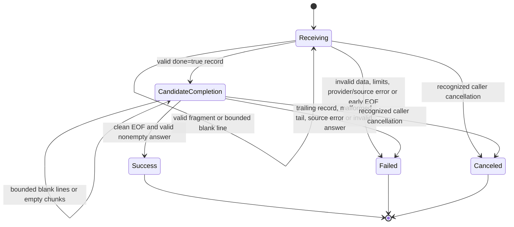

# Scratch local provider streaming and error contract

Day 8 item 4.2. Assistant-authored planning specification at the learner's request, October 19, 2026. **Review COMPLETE; implementation, automated tests and isolated faults PENDING.** Actual review minutes unknown. No client, adapter, parser, retry mechanism or application endpoint is implemented by this document.

📚 Learn first: [Ollama streaming](https://docs.ollama.com/api/streaming), newline-delimited JSON and response media types; [API errors](https://docs.ollama.com/api/errors), errors before and after headers; [Generate API](https://docs.ollama.com/api/generate), completion and timing fields. Official references opened October 19, 2026; the future implementation must check them against pinned Ollama 0.40.6. Stop before framework clients or cloud integration.
↩ Return: use the acceptance table below when separately scoping the learner-written scratch client. Implement parser/transport checks with synthetic fixtures before claiming production readiness or correctness from a live model response. This specification does not authorize code changes.

## Scope and trust boundary

Merlin's future scratch provider client calls only the selected local Ollama generation endpoint. Ollama runs the model; Merlin validates the transport and protocol before treating any answer as complete. The existing process-liveness endpoint stays independent of model/database readiness. Personal Codex/OmniRoute routing is outside this application boundary.

Retain the pinned local model, digest, synthetic inputs and resource policies in [the readiness contract](../evals/local-model-readiness.md). This slice specifies explicit stream=true behavior; earlier stream=false probe results are not streaming-parser proof. No SDK/framework, persistence, tool execution, hosted fallback or extra model is needed. Generated text remains untrusted data and never becomes executable instructions or trusted HTML.

Only the agreed literal loopback destination 127.0.0.1:11434 and fixed local model are permitted. Never derive the destination, redirect target or model from prompt content. Reject unauthorized schemes/hosts/ports and hosted-model selectors before transport creation. Disable redirects and ambient proxy use for this local call. Do not invoke login, pull, remote tools, a gateway or another provider on failure. No credentials are needed. A future hosted route requires its own explicit consent, budget and policy; it is absent here.

## Day 9 item 2.1 — selected files and interface

Design recorded October 20, 2026 at the learner's request. **2.1 COMPLETE for design only; implementation/tests remain PENDING.** Today's selected rung is a pure bounded decoder, not a live HTTP provider connection. Do not create empty files merely to mark the design complete.

| Planned file | Responsibility | Excluded responsibility |
|---|---|---|
| `app/local_provider.py` | Decode supplied byte chunks, enforce the existing framing/schema/completion/error/byte-limit rules and return validated assembled response text. Keep this first decoder in one small module. | No sockets, HTTP status/header handling, model loading, provider discovery, retries, hosted fallback or database access. |
| `tests/test_local_provider.py` | Deterministic cases using synthetic byte iterators with controlled splits, records and failures; applicable isolated faults integrate with the existing audit harness when implemented. | No GPU, internet, real Ollama process, downloaded-model dependency or personal configuration. A fixture must not silently use real transport. |

Selected public function signature, **a specification rather than implementation**:

```python
def decode_response(chunks: Iterable[bytes], *, expected_model: str) -> str:
```

`Iterable` refers to the Python standard-library collections.abc type. The decoder obtains an iterator and consumes it once; tests can supply lists or generators of byte chunks. `expected_model` is supplied by trusted calling code and is never inferred from incoming output. Each yielded chunk must be bytes; reject invalid input types instead of coercing them. Empty chunks carry no output or completion. Arbitrary chunk sizes do not change record semantics. Processing retains the existing 64 KiB record and 256 KiB total-response limits, including the unfinished byte buffer.

Return only the assembled response string after exactly one valid completion and clean end of the supplied stream, with no later nonblank records. Terminal text, if present, is included exactly once in order; unknown metadata does not control the decoder. Do not return partial output, quietly skip malformed records or normalize the response to make exact-answer checks pass. Use the existing contract's smoke-answer and completion requirements.

Failure interface: raise one small module-local exception type, `ProviderError`, with a fixed public message and a stable category attribute. Do not expose raw upstream error strings or input fragments through its message, category or exception chaining. Exact categories and state transitions are specified in 2.3 before implementation; this is not permission to create an exception hierarchy or framework. Iteration/read failures also must not become a successful partial answer. Intentional process interruption is not a provider success.

Ownership boundary: the caller creates and owns the byte source and any future response/connection, closing them on success, error or cancellation. The decoder must not start/stop Ollama, open/close unrelated sockets or unload a model. A pure synchronous iterator cannot itself interrupt an indefinitely blocked `next()` call; future transport must enforce connection/idle/absolute deadlines and cancellation while supplying chunks. Do not claim networking/deadline correctness from this decoder's interface or finite synthetic iterators. Keep future HTTP status/media-type validation outside this byte-only function.

No additional files, SDK, generic gateway, base-provider classes, plug-in registry or network implementation are selected. These roles preserve a later transport boundary without implementing it prematurely. Tests/cases/faults and all source files named above remain unwritten until the learner's implementation task or separate explicit authorization.

📚 Learn first: the framing, bounds and planned-case sections below and the existing Python JSON resource in the Day 9 checklist. Stop before network-client implementation.
↩ Return: Day 9 item 2.2, map the chosen decoder's input/expected-result oracles to the existing LP cases, then item 2.3 fixes error categories/state transitions before coding. Actual design minutes unknown.

## Day 9 item 2.2 — decoder inputs and expected results

Assistant-authored October 20, 2026 at the learner's request. **Input/expected-result design COMPLETE; learner review and every executable test/fault remain PENDING.** These are test specifications, not code or observed outcomes. Item 2.3 still finalizes error categories and state transitions before implementation.

### Fixture notation and common oracle

Every test supplies trusted expected_model `qwen3:0.6b`. Use only these synthetic records; each named record is serialized as UTF-8 with a trailing LF unless a row says otherwise. The notation describes test data, not a supplied implementation.

| Name | JSON record contents |
|---|---|
| A | `{"model":"qwen3:0.6b","response":"Hel","done":false}` |
| B | `{"model":"qwen3:0.6b","response":"lo","done":false}` |
| T | `{"model":"qwen3:0.6b","response":"!","done":true,"done_reason":"stop"}` |
| M | `{"model":"qwen3:0.6b","done":true,"done_reason":"stop"}` |
| E | `{"error":"SYNTHETIC_PROVIDER_ERROR_SENTINEL"}` |

`A + B + T` denotes concatenated wire bytes, not Python string addition to be copied blindly. Square brackets describe successive yielded byte chunks. EOF means the iterator ends normally. A split at offset k yields a prefix then the remaining suffix. Empty chunk is zero bytes; a blank line contains a delimiter and therefore counts toward byte limits. Tests must assert exact returned text, not merely that no exception occurred.

For every negative case require ProviderError, no returned partial answer and no successful completion. Assert a fixed safe public message/category once 2.3 selects them. Do not assert the raw malformed payload or provider message as the public error. Each listed variant is independently parameterized so one passing variant cannot hide another. Use one shared canonical fixture/helper rather than duplicating the whole test body. Intended fault detection remains separate from baseline success.

### Case map

| Case | LP mapping / distinct purpose | Concrete supplied input | Expected result |
|---|---|---|---|
| D-01 | LP-01 ordered assembly | Chunks [A, B, T], then EOF | Exactly Hello! once; no invented separators or normalization |
| D-02 | LP-02 arbitrary boundaries | For every k from 1 to length(A+B+T) minus 1, split the same wire bytes into prefix/suffix | Exactly Hello! for every split; inventory every parameter |
| D-03 | LP-02 many successive splits | Yield the same valid wire one byte at a time, with empty chunks before/between/after | Exactly Hello!; empty chunks neither terminate nor add output |
| D-04 | LP-03 coalescing | One chunk containing all of A+B+T | Exactly Hello!; process all three records |
| D-05 | LP-04 multibyte text | Valid records assembling café🙂; parameterize every split inside the UTF-8 encoding of é and 🙂 | Exactly café🙂; no replacement characters or byte loss |
| D-06 | LP-05 line endings | A+B+T with all LF, all CRLF, then mixed endings; include a split between CR and LF | Exactly Hello! for each variant; endings excluded from text |
| D-07 | LP-05 blank lines | Whitespace-only lines before/between/after A+B+T within byte caps | Exactly Hello!; blank bytes still count toward caps |
| D-08 | LP-05 valid final tail | A+B+T with T's final LF removed; parameterize final chunk split | Exactly Hello! after EOF; valid complete terminal JSON accepted |
| D-09 | LP-06 malformed JSON | A followed by a newline-terminated record missing a required JSON quote or brace | ProviderError; never silently skip bad record and return Hel |
| D-10 | LP-06 duplicate keys | A record containing duplicate done keys, then independently duplicate model/response keys | ProviderError for each; never last-key-wins success |
| D-11 | LP-06 non-finite constants | Valid-looking record with an unknown metadata field set to NaN, Infinity or -Infinity | ProviderError for every constant despite metadata being otherwise ignorable |
| D-12 | LP-06 invalid encoding | Raw byte FF inside a response string, with a complete line ending | ProviderError; strict UTF-8, no replacement or ignored bytes |
| D-13 | LP-07 truncated JSON | A then an unfinished T JSON object, EOF | ProviderError; unfinished tail is not discarded |
| D-14 | LP-07 truncated UTF-8 | A then an unfinished multibyte response character at EOF | ProviderError; no replacement character or partial answer |
| D-15 | LP-08 absent completion | Empty iterator; blank-only stream; A alone; A+B, each ending normally | ProviderError for each distinct state; EOF is not done=true |
| D-16 | LP-09 top-level shape | Each of JSON array, string, null, Boolean and number as a record | ProviderError for each; require an object |
| D-17 | LP-09 required types | Record with missing done; done=1/string/null; response=number/object/null; nonterminal record missing response | ProviderError for each variant; never truthiness/string coercion |
| D-18 | LP-09 identity | Missing model; non-string model; wrong model on first record; change model only on terminal record | ProviderError for each; expected identity applies throughout |
| D-19 | LP-10 metadata-only completion | A+B+M; independently A+B plus M with response empty string | Exactly Hello for both; completion need not repeat prior text |
| D-20 | LP-11/12 provider error before/after text | [E]; independently [A, E]; independently an object containing error plus done=true/model/response | ProviderError, error precedence; no upstream sentinel or Hel returned |
| D-21 | LP-12 malformed error member | Object with error=null, number or object alongside success-shaped fields | ProviderError; presence of error prevents success even when its value is malformed |
| D-22 | LP-13 duplicate terminal | [A, T, M] | ProviderError; no early return before checking the rest |
| D-23 | LP-13 trailing record/data | [A, T, B]; independently [A, T, incomplete nonblank tail] | ProviderError, including when trailing data arrives in a later chunk |
| D-24 | LP-14 empty versus absent content | Empty response fragment followed by A+B+T; separately only empty fragments plus M | First returns Hello!; second raises ProviderError for no nonempty answer |
| D-25 | LP-15 record boundary | Well-formed record with safe padding metadata so encoded record including its LF is exactly 65,536 bytes, followed by M within total cap; independently pad it to 65,537 bytes | Exact-boundary valid text accepted; one byte over rejected before accepting record |
| D-26 | LP-15 unfinished record bound | Yield an unfinished record in small chunks crossing 65,536 bytes without any LF | ProviderError when the cap is crossed; do not wait for EOF/newline to enforce it |
| D-27 | LP-15 aggregate boundary | Construct valid nonterminal records plus terminal, each within record cap, whose combined wire length is exactly 262,144 bytes using safe ignored metadata; independently add one legal blank-line byte | Exact total accepted; 262,145 bytes rejected even if output text is short |
| D-28 | LP-15 blank-line flood | Finite blank/whitespace records whose cumulative bytes cross the total cap while individual records remain bounded | ProviderError; ignoring blank lines must not bypass total accounting |
| D-29 | LP-15 non-ASCII accounting | Valid padded metadata containing multibyte characters; choose below/above wire-byte caps while character count alone remains below | Enforce UTF-8 bytes, not decoded-character count |
| D-30 | LP-19 safe errors | Synthetic provider sentinel in E and a separate synthetic sentinel inside malformed input and iterator exception | Neither sentinel in str(error), ordinary captured stdout/stderr/logs or publicly formatted chained exceptions; safe ProviderError only |
| D-31 | LP-22 no replay / no partial success | Single-use byte source yields A then raises a synthetic read failure; it records iteration attempts and refuses a second iteration | ProviderError; exactly one iteration attempt, no replay, no Hel returned |
| D-32 | LP-22 late source failure | Single-use source yields A+B+T, then raises instead of clean EOF | ProviderError; terminal record alone cannot hide a failed stream ending |
| D-33 | LP-23 benign unknown metadata | Add an unknown safe metadata object to a valid record; separately omit optional timing/token fields | Same exact text; unknown metadata neither changes control flow nor fabricates metrics |
| D-34 | LP-23 length-limited answer | Valid text followed by terminal done_reason=length | ProviderError representing a length-limited answer for this string-only interface; do not return it indistinguishably as a complete normal answer |
| D-35 | LP-23 token-count bound | Valid-looking terminal eval_count=64, then independently eval_count=65; wrong-type/negative eval_count as separate variants when present | 64 allowed if other conditions pass; 65 or malformed count rejected; absent optional count does not become zero |
| D-36 | Interface input contract | Iterator yields a str, None or bytearray instead of bytes; empty bytes tested separately in D-03 | ProviderError for each wrong type; empty bytes are allowed |
| D-37 | LP-19/22/24 no side effects | During success and representative failures, install traps that fail on any attempted socket creation, network client, process start or model-management operation | Decoder returns/raises only its intended result; zero external calls; no fallback/retry side effect |
| D-38 | LP-24 caller ownership | Caller-owned fixture supplies chunks and records close; invoke decoder normally and with malformed data, then caller cleanup | Decoder does not close/kill shared resources; caller fixture closes exactly once in both paths. This proves fixture ownership, not a future network client's cleanup. |

D-02's two-piece splits, D-03's one-byte fragmentation, D-04's coalescing and D-05's targeted Unicode variants protect different processing boundaries; do not remove one solely because another kills the same mutation. D-25–29 distinguish record, unfinished buffer, aggregate, ignored-data and byte-versus-character bounds. D-30–38 protect schema/ownership/side effects separately from framing. Each may share helper logic while retaining its own intended oracle.

### Boundary decisions and transport carryover

- For unambiguous fixtures, the 65,536-byte record cap counts the complete encoded record **including its LF or CRLF when present**; a final record without a delimiter counts its actual bytes. The 262,144-byte total always counts every supplied byte, including ignored blank lines and trailing data. Construct valid exact-boundary fixtures; do not accidentally fail earlier on malformed JSON or another cap. The decoder can bound its own accumulation but cannot undo a giant allocation already made by the caller supplying a chunk.
- The string-only decoder cannot return a distinct completion-reason object. Therefore D-34 rejects length-limited output as a safe categorized failure rather than hiding that distinction. This is a design decision for unimplemented software, not a changed expected result to make an existing failure pass. Item 2.3 must assign its fixed category/message. A future structured-result interface, if needed, requires an explicit design change.
- LP-11's **HTTP-status/media-type** half is deferred to transport; its JSON error-object half is covered in D-20/21. Do not pass HTTP arguments into this byte-only function merely to claim the entire LP row is implemented.
- LP-16–18's connection/idle/absolute deadlines and in-flight cancellation, LP-20/21's actual destination/redirect/proxy/hosted-call guards, and LP-24's network-response cleanup remain **PENDING transport implementation**. D-37 proves the decoder itself makes no external calls, not a nonexistent transport's safe routing.
- A finite synthetic iterator and bounded byte count do not prove deadlines or cancellation of a blocked or endless-empty iterator. Caller/transport ownership remains as specified in 2.1. Do not introduce hidden background workers or global service kills to claim these checks.
- Timing metrics, first-token timestamps and a quality golden set are not outputs of decode_response returning str. Missing optional metadata is accepted as absent; no metrics are fabricated. The broader provider retains its future evidence obligations.

### What the learner still does

Review the record names and expected results above, especially completion only after clean EOF, provider-error precedence, exact byte boundaries and length-limit rejection. Ask about any outcome that is unclear before coding. Item 2.3 still needs the small state diagram and fixed public error categories/messages. Then the learner writes the decoder and executable tests in the two planned files; assistant code changes need separate explicit authorization. Every D case, isolated fault and CI integration is currently **PENDING**, regardless of this table's completion. No tests, fixtures, fault runners, application code or model requests were created/executed for 2.2.

📚 Learn first: the existing framing/completion rules and LP table below; revisit Python JSON decoding resources from the Day 9 checklist for strict JSON behavior. Stop before writing an HTTP client.
↩ Return: review this input/expected-result table, then complete 2.3 before the first implementation attempt. Record actual minutes if known; current design minutes are unknown. Learner understanding remains separate from assistant-authored planning completion.

## Day 9 item 2.3 — states, safe failures and limits

Assistant-authored design completed October 20, 2026 at the learner's request. **2.3 specification COMPLETE; learner review, implementation, executable tests and isolated faults PENDING.** No source files or new dependencies were created. Actual design minutes unknown. This section finalizes the decisions requested by 2.1/2.2; their earlier future-tense references describe the preceding design steps.

### States and allowed transitions

These are internal decoder states, **not HTTP status codes**. They describe one call; a new call starts a new state machine.



| State | Meaning and permitted work | Exit rule |
|---|---|---|
| Receiving | Count supplied bytes, buffer bounded incomplete records, strictly decode/validate complete records and collect response text privately. No successful result has been returned. | Valid done=true becomes CandidateCompletion. EOF without completion is a failure, even after readable text. |
| CandidateCompletion | A terminal record was valid, but the source has not yet ended cleanly. Include terminal text once; accept only bounded blank lines/empty chunks afterward. | Clean EOF and a valid nonempty assembled answer become Success. Extra nonblank records, corrupt tails or source errors fail. A fully valid final record without newline can be processed at EOF. |
| Success | Return the exact assembled response string once. | Terminal. No additional source iteration, callbacks or side effects after returning. |
| Failed | Raise safe ProviderError with a fixed category/message. Do not return accumulated text, restart iteration, retry or continue parsing more chunks. | Terminal for this call; caller performs its owned cleanup. A new request requires an explicit new call. |
| Canceled | Stop processing and do not return partial output. Close/stop only resources owned by the caller. | Terminal for this call. No automatic restart or conversion to Success. Server-side cancellation is not proven by this state. |

The selected function returns only after success; it exposes no provisional-output callback or streaming iterator of decoded text. This keeps partial text private to the implementation. The caller must not treat an exception as a successful empty answer. Program-control exceptions such as KeyboardInterrupt/SystemExit must not be swallowed or relabeled as ordinary provider success. A synchronous byte iterator provides no independent deadline/cancellation control over a blocked next(); transport cancellation remains separate future work. No background worker or global service termination is introduced to implement this diagram.

### Fixed decoder error interface

One planned ProviderError type has a category attribute and a fixed message from this table. No raw provider payload, source exception message, private sentinel or partial response is attached as a public detail field, message or displayed chained exception. Suppress private exception chaining in the public presentation. Do not broadly catch programmer errors merely to pretend the decoder is working; unexpected defects remain visible to tests without publishing private input.

| Category | Fixed public message | Trigger / expected-case mapping |
|---|---|---|
| invalid-response | Invalid model response. | Malformed JSON/UTF-8, duplicate keys/non-finite values, wrong input/record/field types, wrong model, malformed counts, duplicate completion or nonblank data after completion; D-09–12, D-16–18, D-22/23, invalid-count variants of D-35, D-36 |
| incomplete-response | Model response was incomplete. | Missing completion, EOF in JSON/UTF-8, empty assembled smoke answer; D-13–15 and empty-answer variant of D-24 |
| limit-exceeded | Model response exceeded a limit. | Encoded record >65,536 bytes, total >262,144 bytes, unfinished buffer crossing its limit, or valid integer eval_count >64; D-25–29 and over-cap D-35 |
| provider-failure | Local model request failed. | Any error member in a parsed record, including malformed error values or error together with done=true; expected source read/iteration failures such as OSError; D-20/21/30/31/32 |
| length-limited | Model response reached its output limit. | A valid terminal done_reason=length, without a higher-priority violation; D-34. The string-only interface must not return this as an indistinguishable normal answer. |
| canceled | Model request was canceled. | An explicit trusted caller cancellation signal, when a future source/caller supports it. Not inferred from arbitrary provider text or EOF. This interface's active cancellation mechanism is PENDING; no new argument is silently added. |

Future transport additionally needs fixed unavailable, timeout and missing-model categories, plus safe non-2xx/media-type handling. They are **not implemented or verified by the byte-only decoder**. An iterator's TimeoutError may be classified by the future transport; do not invent a measured decoder deadline from a finite fixture. The caller's cleanup failure must stay visible as a safe failure rather than being suppressed or printing its raw exception. Exact transport/cleanup exception APIs are deferred; this table does not authorize network code.

Precedence: enforce wire-byte bounds before accepting excess input; strictly parse JSON/UTF-8 before inspecting fields; then any parsed error member overrides successful-looking fields. Validate ordinary field types/model/counts and state before accepting normal fragments or completion. Valid length termination is length-limited; malformed metadata or a breached byte/token cap remains its actual validation/limit failure. Once a failure is selected, do not inspect later chunks to replace it with a more convenient outcome. Trailing data cannot turn CandidateCompletion into success. Missing optional metrics remain absent, never zero.

### Explicit byte and token bounds

- One record: **64 KiB = 65,536 encoded bytes**, including its LF or CRLF when present. A delimiter-free final record counts the bytes actually supplied. An unfinished record cannot exceed that cap while waiting for more data. Count delimiters split across chunks consistently.
- Whole supplied response: **256 KiB = 262,144 bytes**, including metadata, blanks, delimiters, trailing data and unfinished bytes. Exact boundary is allowed if every other rule passes; one byte above fails. Count the original bytes once, never the number of Unicode characters or only assembled response text.
- eval_count, when present, must be a genuine nonnegative integer rather than a Boolean; at most **64** for this bounded request. An absent count cannot prove model token usage. No tokenizer is introduced to infer output tokens from string length.
- Empty chunks contribute zero bytes; blank lines contribute their wire bytes. Neither grants completion or resets total accounting. The decoder's cap limits its own retained buffer; it cannot reverse memory already allocated by its caller for a supplied giant chunk.
- No success before clean source termination, no partial result on any terminal failure and no output accepted after Failed/Canceled. Do not weaken these rules to make malformed synthetic cases pass.

### Synthetic sentinel and effectiveness plan

Use only these clearly artificial markers in future isolated fixtures. Their names and values are safe to publish; never substitute a real key, prompt, path or personal error to make the test realistic.

| Sentinel | Planned injection point | Required absence / observation |
|---|---|---|
| SYNTHETIC_PROVIDER_ERROR_SENTINEL | JSON error field, before text and after partial text | Absent from public result/error and ordinary logs; provider-failure with fixed message |
| SYNTHETIC_MALFORMED_INPUT_SENTINEL | Malformed JSON or invalid record payload | Absent from public error/logs; safe invalid-response |
| SYNTHETIC_SOURCE_ERROR_SENTINEL | Exception raised by a caller-owned byte source | Absent from public message/displayed exception chain/logs; no replay or partial success |
| SYNTHETIC_CLEANUP_ERROR_SENTINEL | Caller-owned disposable fixture cleanup failure | Safe cleanup failure remains visible; raw marker absent from public errors/logs; decoder never kills a shared service |

Before implementation, attach these fixed category/message expectations to D-09 onward where applicable. Successful cases still assert exact text. Later fault injection must separately prove that bypassing completion/error precedence/limits or leaking a marker fails its intended assertion; simply observing ProviderError or a setup failure is insufficient. No executable sentinel checks or faults exist yet.

### Protocol design is not AI quality evaluation

The decoder cases ask whether bytes, framing, limits and failures are handled correctly using known synthetic inputs. They do not measure whether a real model answers a user's question well. A future AI quality claim still requires **at least 20 labeled task cases**, an agreed baseline, a quality metric with a predeclared threshold, measured latency and cost/token evidence. Neither the 38 decoder case families nor the 24 broader protocol rows substitute for that golden set. Original Ready. compliance failure and unmeasured first-token/peak/cancellation evidence remain unchanged.

### Learner review before coding

The assistant's requested design work for 2.3 is complete. The learner's remaining review is to explain why CandidateCompletion is not Success, what happens after a terminal failure and which bytes count toward the two caps. Confirm or ask about the fixed failure meanings, especially incomplete-response versus provider-failure and length-limited output. Then proceed to 3.1 and personally write the decoder; actual code/tests/fault integration remain PENDING and are not authorized by this document.

📚 Learn first: the state diagram, category table and existing D-case input/expected-result map immediately above. Stop before live transport or framework work.
↩ Return: explain the three review points in your own words, then implement only the agreed pure decoder slice. No new source file, test, package, model request, commit or push was created by this design task.

## Day 9 item 3.1 — learner implementation order

Preparation reviewed October 22, 2026. The learner's final 2.3 answer correctly selected a safe error with no automatic retry; its explain-back review is complete. No provider source/test file exists at this review. **3.1 implementation remains PENDING and learner-owned.** Assistant preparation consists of this implementation guide and the existing interface/oracles, not decoder code.

1. Create app/local_provider.py yourself. Use only standard-library facilities. Define the agreed safe ProviderError interface and decode_response signature from 2.1; do not add network code or start Ollama.
2. Track total received wire bytes, a pending record buffer and a list of accepted response fragments. Chunk boundaries are not record boundaries. Reject non-bytes items, count each supplied byte once and enforce the 262,144-byte total before retaining oversized data.
3. Consume each chunk in record-sized portions, scanning for LF. Finish every complete record in order, retaining only its incomplete tail. Enforce 65,536 bytes for each encoded record, including LF or CRLF, and for the unfinished buffer. A large chunk containing many short valid records must not fail merely because the entire chunk exceeds the per-record cap. Avoid copying an arbitrarily large chunk into the pending buffer before enforcing its cap.
4. For a complete nonblank record, strictly decode UTF-8 and parse JSON. Python's default JSON decoder accepts duplicate names and non-finite constants; use object_pairs_hook to detect repeated keys, including nested objects, and parse_constant to reject NaN/Infinity/-Infinity. Never replace invalid characters or silently skip malformed records. Existing Python JSON documentation was re-opened October 22.
5. Require a JSON object, apply error-member precedence, then validate model identity, genuine Boolean done and required response-string shape. A Boolean must not pass as an integer token count. Retain valid nonempty/empty fragments in exact order without trimming or normalizing their content. Terminal metadata-only records are handled under 3.2's completion rules.
6. On source end, distinguish a valid complete last record without LF from truncated JSON/UTF-8. Do not attempt to parse an incomplete tail as if an absent newline meant success. Joining fragments belongs only on the eventual success path, after 3.2's terminal-state and clean-EOF checks. Do not use the growing output text as the only buffer or limit counter.
7. Before considering 3.1 verified, compare the attempt against D-01–18 and applicable D-25–30/33/35/36 cases, using the existing input/expected-result table. Those tests remain to be written. Keep absent/duplicate completion, trailing errors, private source failures and no-partial-success enforcement open until 3.2 and the required checks exist. A temporarily unfinished function is not a completed decoder and must not be wired to live transport.

Python resources: [JSON decoder](https://docs.python.org/3.12/library/json.html), object_pairs_hook, parse_constant and JSONDecodeError; read the strictness notes rather than copying the full examples. Keep fixed messages/categories from 2.3 and distinguish malformed complete records from truncated input. Programmer defects are not an excuse for a catch-all that swallows errors.

📚 Learn first: 2.1's interface, 2.2's fixture definitions/boundary cases and 2.3's state/error tables above. Stop before HTTP implementation.
↩ Return: spend the planned 25-minute attempt writing the learner-owned file, then bring the actual code/first blocker for review. If the attempt does not fit, record actual minutes or unknown and continue later without claiming 3.1 complete. No new package, fixture, test, model request, commit or push was produced by this preparation.

### First learner implementation review — October 22, 2026

Reviewed app/local_provider.py with isolated in-memory synthetic observations; no application code or permanent tests changed. **3.1 remains incomplete.** No tests/test_local_provider.py exists yet; these review observations are not suite integration or fault-effectiveness proof.

- A valid model/response/done stream returned an empty list because the implementation reads text/content instead of the agreed response field. The selected interface also lacks keyword-only expected_model and returns a list instead of the specified assembled string.
- Wrong or missing model, non-Boolean done and numeric response were accepted. Model type alone is not identity validation; required field presence/types must be checked against the contract.
- JSON NaN and Infinity were accepted: parse_float rejects overflowing numeric exponents but does not receive named non-finite constants. Add the agreed parse_constant rejection alongside finite float checking; retain duplicate-key rejection.
- A 65,537-byte unfinished record was accepted and retained. Per-record checking runs only after LF, and feed copies the entire chunk into the buffer first. Enforce the unfinished-buffer limit while consuming bounded portions; retain total-wire-byte accounting and allow a large chunk containing multiple individually valid records.
- Wrong chunk type raised raw TypeError instead of the safe classified error. ProviderError lacks its category and fixed message interface. A synthetic error sentinel was echoed publicly; raw decoder exceptions are also chained. Do not expose input keys, provider messages or raw decoder details in public errors.
- An error member with None/False was ignored because the code tests truthiness. Member presence must prevent success regardless of its value. First strict parsing, then error precedence, then ordinary schema validation.
- A malformed EOF tail after a text fragment was ignored and returned partial text. Full completion/state handling belongs to 3.2, but this partial return must not be represented as a working safe decoder; keep it out of live use until clean EOF/completion rules pass.

Next learner action: correct field/interface and validation, then enforce unfinished-buffer bounds and safe failures. Bring the revised attempt for review. Keep 3.2 terminal-state work separately open; no automatic retry, network wiring or weakened assertions is indicated by this review.

### Second learner implementation review — October 22, 2026

3.1 remains open after read-only review and synthetic in-memory observations. The revised implementation now returns Hi! for valid response-field records and rejects named non-finite constants/error-member presence. Remaining observed failures: a 65,537-byte LF-terminated record is accepted because the check omits the LF; the whole chunk is still copied before per-record enforcement; exponent overflow 1e999 is accepted after finite-float validation was removed; missing done is accepted; expected_model remains optional; non-bytes input raises raw TypeError; ProviderError still lacks the fixed category interface and retains raw JSON/Unicode exceptions as explicit causes. A valid complete final record without LF is rejected. No source/test edits or permanent tests were made.

Next fixes: count newline bytes, enforce bounded incremental buffering, combine parse_constant with finite parse_float checking, require the trusted keyword-only expected_model and mandatory Boolean done, and use the agreed safe categorized errors without displayed raw chaining. Terminal metadata-only records, valid EOF tails, exactly-one completion and no partial success remain 3.2 obligations; this review does not mark them complete.

### Third learner implementation review — October 22, 2026

Read-only synthetic checks confirm the revised response assembly, required keyword-only model argument, wrong-model/missing-done/non-bytes rejection and named/overflow non-finite rejection now work. 3.1 remains open: newline-containing chunks are still copied in full before the record cap (65,537 bytes retained on the demonstrated failure); JSON/Unicode failures display implicit original exception context without suppression; public categories/messages differ from the fixed 2.3 table; eval_count above 64 is accepted. Enforce incremental per-record accumulation without rejecting otherwise valid coalesced records, suppress raw error chaining, use the agreed fixed error map and validate optional token-count metadata. Full completion/EOF semantics remain 3.2 work. No application code or permanent tests were changed.

### Authorized 3.1 repairs and cleanup — October 22, 2026

The learner explicitly authorized the assistant to repair and refactor the remaining 3.1 issues. The assistant updated app/local_provider.py and authored tests/test_local_provider.py for these previously designed requirements. Kept the learner's decoder structure and pure byte-source boundary; no networking, retry, package or model changes.

Implemented incremental record-sized copying through a memoryview instead of buffering a whole coalesced chunk; enforced delimiter-inclusive record caps and total-wire-byte caps before accumulation; retained duplicate-key and named/overflow non-finite checks; used the fixed category/message map and suppressed private parser exception chaining; validated optional genuine integer eval_count against 0–64. Safe handling also covers malformed oversized JSON integers and nesting failures. Cleaned unused imports/spacing and added accurate Iterable/type annotations. The module explicitly warns that completion-state handling remains pending.

**3.1 PASS for its record-buffering/schema-validation scope.** Forty-one focused regressions passed, covering exact/one-over byte boundaries, unfinished buffers, coalesced records, all split positions in synthetic Unicode input, duplicate/nested keys, non-finite values, field types/identity, token-count boundaries, wrong chunk types, error-member precedence and safe messages/chaining. Four isolated in-memory counterfactuals (bypassed record cap, relaxed token cap, exposed error chain and truthy-only error detection) each failed its intended test; no faulty code was installed. These four observations do not establish individual effectiveness for every new case.

Nearest existing regressions passed: 202 note/maintenance cases and 30 API/probe cases; **273 focused cases passed in total**, including the 41 new ones. A second review kept the patch within 3.1, followed by rerunning those 41 cases after final documentation/spacing cleanup. No full-suite/hosted PASS is claimed for the expanded working tree. New provider tests are **not yet registered with the complete case/fault inventory or permanent fault harness**; that integration and its full-suite/CI verification remain explicitly open under Day 9 step 4.3. Historical full-suite results predate this new module/test file and cannot certify them.

**3.2 remains open:** exactly-one completion, metadata-only terminals, clean EOF with a valid delimiter-free final record, length-limited response policy, no response after terminal failure and source-failure/cancellation semantics. The public function can still return text without enforcing those state rules; do not wire this partial decoder to live transport or describe it as a completed provider client. No commit/push was performed. Actual repair/review minutes unknown; record overrun/carryover rather than assuming it fit the original 25-minute block.

### Authorized 3.2 implementation — October 23, 2026

The learner explicitly requested that the assistant implement 3.2 after the learner's partial attempt. The assistant changed app/local_provider.py and tests/test_local_provider.py. This authorization covers these completion semantics and their tests, not automatic publication, live transport or unrelated feature work. Earlier 3.2-PENDING statements are historical snapshots superseded for the implementation scope by this receipt.

The decoder now tracks one validated terminal, permits metadata-only completion, includes terminal text once and returns only after clean EOF with nonempty text. Parsed error members take precedence even after a candidate terminal. Ordinary later records and corrupt trailing data fail. Complete delimiter-free final records and bounded blank tails are handled; truncated final JSON/UTF-8 is separated from malformed input, with targeted cases for partial literals, numbers, escapes and invalid syntax. Length termination raises the fixed length-limited error after other validation. Expected OSError during iterator acquisition/advancement becomes fixed provider-failure with displayed private chaining suppressed. Source replay is absent; unexpected/program-control exceptions propagate. Byte limits and caller resource ownership remain intact. Removed the unused has_error flag and the invalid duplicate-category exception call.

Final focused command: `.venv/bin/python -m pytest -q tests/test_local_provider.py tests/test_note_rules_and_maintenance.py tests/test_health_api.py tests/test_database_connectivity_probe.py`. **349 cases PASS in 3.34 seconds: 117 provider cases plus 232 existing cases.** Loopback API fixture execution required permission outside the socket-restricted sandbox. The initial implementation baseline passed 107 provider cases, followed by 344 combined cases; review added numeric/Unicode-tail distinctions and caller-ownership/metadata checks before the final run. Existing provider assertions were preserved. The second pass reviewed clarity and scope and corrected EOF classification/comment details; no performance improvement is claimed.

Four isolated in-memory source counterfactuals detected their intended negative assertions: trust EOF without completion, return at the first terminal, ignore error-member presence and ignore length termination. No faulty code was installed. Three used retained test functions; error-presence detection used the equivalent pytest.raises outcome oracle in memory. These are finite observations, not permanent harness integration or proof for every case. The new cases are not yet registered with the retained suite/fault inventory. Full-suite execution, permanent fault integration and exact expanded-source hosted CI remain **PENDING under 4.3/4.4**. No commit, push, model request, service change or database change occurred.

**3.2 implementation verified within this scope; learner explanation remains PENDING.** The learner explicitly reported not answering the preparation questions. Do not attribute assistant code or explanations to independent learner mastery. Live transport, blocked-read cancellation and server cancellation remain unimplemented; this pure decoder does not establish AI quality. Actual work minutes are unknown; the 15-minute allocation is not certified.

📚 Learn first: the existing state/error tables and [the preparation guide](../learning/provider-completion-preparation.md), expected outcomes and exception context limits.
↩ Return: the learner explains candidate completion, failure after terminal and metadata-only completion, then reviews the assistant-authored changes. Continue the remaining Day 9 verification/integration scope before live transport or a completion claim for the entire story.

## Response framing and completion

1. Check HTTP status and media type before consuming output as a successful generation. For success require HTTP 200 with application/x-ndjson (optional charset parameters allowed). Non-2xx responses are errors even if the connection completed normally. A JSON error response may use application/json. Never interpret HTML or another media type as model output.
2. Treat network chunks as arbitrary bytes. One chunk can contain several records, part of a record, or part of a UTF-8 character. Accumulate bytes until a full newline-delimited record is available; decode strictly only complete records or use an incremental strict decoder. Preserve original text order without inserting spaces or losing punctuation.
3. Accept LF and CRLF record endings; ignore whitespace-only lines within the same byte/time limits. Every nonblank record must be one JSON object. Reject invalid UTF-8, malformed JSON, duplicate object keys, non-finite numbers and non-object records. Never silently repair, skip or coerce a corrupt record.
4. Normal records must identify the expected model and carry a genuine Boolean done. A present response field must be a string; nonterminal generation records require it. A terminal metadata-only record may omit response or contain an empty response. An empty-string fragment is valid but does not count as a first generated-content event. Thinking content, if unexpectedly present with think=false, is not surfaced as the final answer or written to public logs.
5. Handle an error member before success/completion processing, regardless of HTTP 200, prior fragments or a concurrent done field. Stop with a generic provider error. Do not append error text to the generated answer. Ollama documents that mid-stream errors cannot change already-sent HTTP headers.
6. Exactly one done=true record is required. A candidate terminal record is not final success until the response ends cleanly with no additional nonblank records. Reject multiple completions, records after completion, model changes and wrong field types. Unknown metadata fields may be ignored within byte limits; they must not alter control flow or routing.
7. At EOF, accept a final non-newline-terminated record only if it is complete valid JSON satisfying the same schema. An incomplete UTF-8 sequence or JSON record is truncation. Clean EOF without done=true, including EOF after valid partial text, is an incomplete-generation error. Do not require a network chunk to end at a token boundary.
8. Provisional fragments may be displayed only as explicitly incomplete output. Do not persist, score or publish them as a completed answer after error, cancellation or missing completion. For this bounded smoke task require some nonempty final response content. done_reason=length is completed transport with a length-limited answer, not proof of task success. Exact READY compliance remains a separate content check.

## Bounds, retry policy and cancellation

Use the existing 2048 context, 64-output-token request cap and synthetic prompt at most 256 UTF-8 bytes. Parser policy: at most 64 KiB per record and 256 KiB cumulative response bytes, including delimiters, metadata and blank lines. Fail before accepting excess data; byte limits include the unfinished buffer so a missing newline cannot grow it indefinitely. An observed token count above the requested bound is failure. Output text must not change the request's limits.

Connection deadline is 2 seconds; total deadline is an absolute 60 seconds from request start, including connection, headers, initial loading and all reads. Add a 10-second maximum interval without received bytes, subject to the same total deadline. These are explicit future-client policies; the earlier curl probe did not prove an idle-read timeout. Resetting an idle timer on receipt must never extend the total deadline. Bound header reads, connection establishment and cleanup as well as body parsing. Respect transport cancellation while waiting; an EOF/exception caused by cancellation must not become success.

**Automatic retry count is zero.** No retry after timeout, malformed response, mid-stream error or user cancellation; no silent replay of partial generations. Report the classified failure and let a deliberate new caller action create a new request. A future retry policy requires separate design/effectiveness proof and must not reset the original operation budget or send data to another provider.

On cancellation/deadline/protocol failure, stop yielding data and close the request's connection/response. Distinguish a requested cancellation from an observed termination of server work. The application client must never kill a shared Ollama service, unload another request's model or stop unrelated processes to cancel one request. A disposable test may terminate only its own fixture/process group, with cleanup bounded to 10 seconds. Until supported in-flight cancellation is observed, record **server-side cancellation PENDING** and prevent the failed operation from being treated as complete or silently retried. Do not claim cancellation from a deadline that expired before the handler started.

## Safe errors and diagnostics

Return only fixed public messages/categories: unavailable, timeout, canceled, missing-model, invalid-response or provider-failure. Caller-visible responses and ordinary logs must not contain raw provider errors, exception/traceback text, prompts, generated private content, credential-bearing URLs, account configuration or local file paths. HTTP status is safe evidence when actually received; no received status is absent/unknown, not an invented HTTP 500. Never echo a failing payload to explain a validation error.

Synthetic fixtures may contain clearly artificial sentinels to prove redaction. Assert their absence in every public response and ordinary log path, including exceptions before headers, mid-stream, decoding and cleanup. Diagnostic artifacts must use explicit allowlisted fields such as category, synthetic case ID and measured timings; private raw logs are not automatic publication artifacts. Sanitization failure is a test failure, not grounds to remove the sentinel check.

## Planned cases and intended fault detection

All rows below are **PENDING implementation/test/fault execution**. They are specifications, not existing tests. A future fault must be isolated and fail its intended assertion; setup errors or a generic red result do not establish effectiveness. Keep the full case/fault inventory and actual failures when integrating into cumulative CI.

| ID | Input/boundary | Required outcome | Intended isolated fault |
|---|---|---|---|
| LP-01 | Valid fragments plus final completion | Exact ordered reconstructed response, one success | Drop/reorder/duplicate fragments |
| LP-02 | JSON record split at every byte boundary | Same result for every split | Parse individual network chunks |
| LP-03 | Multiple records in one chunk | Consume every record in order | Consume only first record |
| LP-04 | Multibyte UTF-8 character split across chunks | Preserve character | Decode each chunk independently |
| LP-05 | LF/CRLF, bounded blank lines, valid final record without newline | Consistent accepted result | Treat record delimiter as output or drop final record |
| LP-06 | Malformed JSON, duplicate keys or invalid UTF-8 | Invalid-response, no final success | Skip/repair corrupt record |
| LP-07 | EOF during a JSON or UTF-8 sequence | Truncation error | Discard unfinished tail and report success |
| LP-08 | Valid partial records but no done=true | Incomplete-generation error | Treat EOF as completion |
| LP-09 | JSON scalar/array; wrong response/done types; wrong model | Invalid-response | Coerce types or ignore identity |
| LP-10 | Terminal record with no text after valid fragments | Accept metadata-only completion | Require text in every record |
| LP-11 | Error object under non-2xx status | Generic classified error, no generation | Ignore HTTP failure |
| LP-12 | Error object mid-stream under HTTP 200, also with done=true | Generic error, partial output not committed | Trust HTTP 200 or prioritize done over error |
| LP-13 | Duplicate completion or record after done | Reject stream | Return immediately at first done and ignore trailing data |
| LP-14 | Empty fragments/terminal-only empty answer | No first-content timestamp; no successful smoke answer | Count empty output as generated content |
| LP-15 | Oversized record, unfinished buffer or cumulative blank-line/metadata flood | Stop at byte cap, bounded memory | Bound only completed/output text |
| LP-16 | Connect stall, no headers, idle stream, endless slow trickle | Correct connect/idle/absolute timeout classification | Reset total deadline for every chunk |
| LP-17 | Cancel before request, during blocked read and after partial output | No further output/retry; request resources close | Ignore cancellation until next complete line |
| LP-18 | Fixture confirms inference started, then client cancels | Observe owned fixture work termination or mark server cancellation PENDING/FAIL honestly | Claim cancellation from client exit alone |
| LP-19 | Private synthetic sentinel in provider, decoder or cleanup error | Sentinel absent in public output and ordinary logs | Echo raw exception/error payload |
| LP-20 | Local failure with an unauthorized hosted provider configured as a temptation | Exactly zero hosted transport calls, no redirects/proxy bypass | Fallback or retry through another provider |
| LP-21 | Unauthorized endpoint/model selector before transport; hostile redirect | Zero unauthorized requests | Validate only after connection or follow redirect |
| LP-22 | Transport/protocol errors after partial text | Zero automatic retries and no completed partial answer | Retry entire generation or commit partial answer |
| LP-23 | Valid terminal with length stop, unusual metadata, missing optional metrics | Preserve length-limit category; optional metrics unknown; metadata does not control routing | Treat missing metrics as zero or length stop as task success |
| LP-24 | Failure during response close or owned fixture cleanup | Public error remains generic; cleanup failure visible; no shared-service kill | Suppress cleanup failure or stop global service |

The table is a transport/protocol test specification, **not** the ≥20-case labeled golden set for AI quality. Synthetic local fixtures must exercise each distinct boundary and require zero external network use in CI. Live Ollama results are supplementary pinned hardware observations and cannot substitute for parser, retry, non-disclosure or cancellation tests.

## Evidence and handoff

Current manual observations stay in [local model readiness](../evals/local-model-readiness.md). Future code/test filenames are selected only when the implementation slice is agreed; do not create empty modules or tests now. Record case-level PASS/FAIL/PENDING and first failure only after execution. Measure request wall time, first byte and first nonempty generated-content delivery separately. With streaming, content-delivery latency still is not a direct timestamp of the model's internal first-token computation.

Day 8 item 4.2 is complete for **requirements review**. Every implementation, automated case, isolated fault and provider-client CI integration above remains **PENDING**. The original model watchdog, exact READY compliance failures, unmeasured resource peaks and unmeasured first-token latency remain open in their original evidence. No permission to rewrite application code, install packages or publish is implied.
