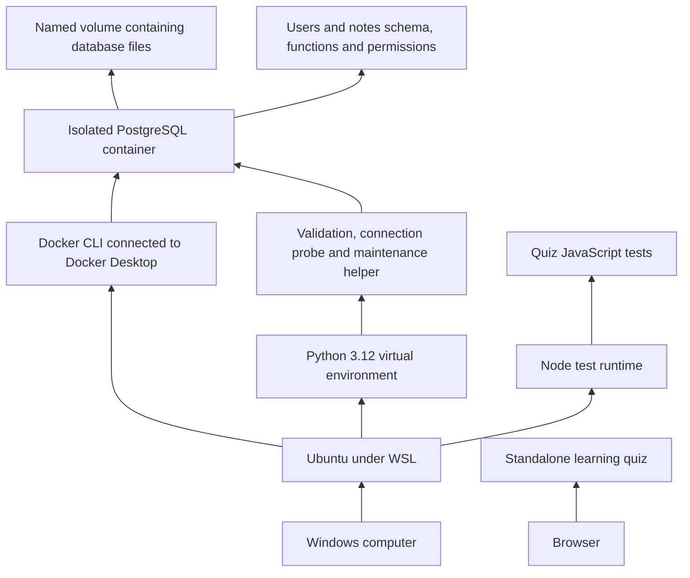

# How Merlin works today: from the computer to the database and tools

This guide describes the files inspected on October 11, 2026 and the latest verified runtime evidence. It explains the current implementation, rather than treating the roadmap as a finished application. Reading this guide does not change the database or complete a learning requirement automatically.

## 1. First, understand what you have

You have a development environment, an implemented users/notes database foundation, three Python helper modules, setup and verification tools, an interactive learning quiz, and extensive tests. These pieces can run independently. You do not yet have a complete notes application that a person can log into and use through a notes editor.

The current system has these layers:

The browser quiz is separate from the notes database. It does not save notes, authenticate users or connect to PostgreSQL. A future notes UI and backend would connect those user-facing operations; they are not present today.

| Piece | Exists now? | What that means |
|---|---|---|
| WSL/Ubuntu development environment | Yes, recorded setup evidence | Commands and project files live in Linux. |
| Docker Compose infrastructure | Yes | Configuration defines PostgreSQL and Redis services. |
| Users/notes schema | Yes, installed in the isolated Day 6 database | Tables, constraints, triggers, policies and cleanup functions have executed tests. |
| Python validation | Yes | Functions validate values when explicitly called. |
| Python connectivity probe | Yes | A command can prove a connection and a simple read succeed. |
| Maintenance helper | Yes; not running as a service | A foreground command can call cleanup functions. |
| Learning quiz | Yes | A standalone HTML page provides local practice. |
| Notes login, API and editor | No | No complete browser-to-backend-to-database note-saving path exists. |
| AI, retrieval, agents and deployment | Planned | No implemented Merlin inference or deployment is established. |

Some older documents, including the root README and Sprint 0 setup instructions, still say there are no application dependencies, schemas or application tests. Those statements describe an earlier stage. Current source and the [effectiveness audit](../testing/case-effectiveness-audit.md) establish the later foundation. Similarly, old comments in migration 001 call it an unapplied draft with pending tests; the later execution evidence supersedes those comments. This guide records that discrepancy without silently rewriting history.

## 2. The bottom layer: Windows, WSL and your files

Windows is your host operating system: the environment where your desktop, browser and Windows applications run. WSL provides a Linux environment on that computer. Your active project is in Ubuntu at `/home/vipra/Merlin`.

The terminal running Bash interprets commands such as `uv`, `python`, `git` and `docker`. The terminal is an interface for launching programs; it is not the backend of Merlin. VS Code is an editor. Its WSL connection lets it edit and run commands against the Linux project.

Windows Explorer can reach those same files through `\\wsl.localhost\Ubuntu\home\vipra\Merlin`. The old `C:\Users\vipra\Merlin` directory is a separate, stale copy according to the setup evidence. Editing one copy does not automatically update the other.

There are several different kinds of state on this computer:

| State | Example | Where it belongs |
|---|---|---|
| Source files | Python modules and migration SQL | Repository directory |
| Private configuration | `.env` | Local ignored file |
| Installed dependencies | Python packages in `.venv` | Local environment recreated from declarations/lockfile |
| Database contents | Stored users and notes | Docker named PostgreSQL volume |
| Quiz progress | Selected answers | Browser local storage |
| Agent preferences | Global Caveman instructions | User home directories, outside the app |

Copying the repository does not copy all these kinds of state. This is why cloning a Git repository is different from reproducing an entire working machine.

📚 Learn first: [Docker Desktop and WSL](https://docs.docker.com/desktop/features/wsl/), read how the Linux environment accesses Docker Desktop. Official page opened October 11, 2026.
↩ Return: identify the host, the Linux workspace and the location of the actual project files. Explain why the Windows copy can differ from the WSL copy.

## 3. Git: how source is recorded

Git records versions of selected files. A commit is a recorded snapshot of tracked source. A push sends commits to a remote repository. A local file can exist without being committed or pushed, so the current checkout can contain work missing from GitHub.

`.gitignore` excludes `.env`, other private `.env.*` files, `.venv`, Python caches, `node_modules` and `.tools`. It explicitly allows `.env.example`, which lists configuration names without a usable password. Ignoring a file does not remove it from Git if it was already tracked, and it does not erase a secret from older commits.

Your database volume is not an ordinary source file in the repository. A commit of a migration records instructions for changing a database; it does not take a snapshot of the running database's rows.

`AGENTS.md` controls how assistants work in this repository. It requires honest claims, appropriate file names, meaningful tests and preservation of functionality and security. The planning instructions normally reserve feature implementation for you; earlier explicit requests authorized the assistant's targeted repairs and test work. Authorship and learner understanding are separate from whether a test passes.

## 4. Python: interpreter, environment and dependencies

The interpreter executes Python instructions. This project requires Python `>=3.12,<3.13`. `.python-version` selects the intended interpreter; `pyproject.toml` declares the project and dependencies; `uv.lock` records resolved dependency information; `.venv` holds the installed project environment.

`uv` manages that environment. It is not Python itself and is not an application server. `uv sync --locked` installs the declared environment while requiring the lockfile to remain consistent. `uv run --locked ...` runs a command in the project environment using the locked setup. A lockfile helps reproduce dependencies; it does not reproduce Docker's database contents or the server's separate Python runtime.

| Dependency | Pinned version | What your code uses it for |
|---|---:|---|
| Psycopg with binary package | 3.3.6 | Connect Python to PostgreSQL and execute SQL. |
| emoji | 2.16.0 | Recognize complete emoji sequences. |
| regex | 2026.9.29 | Split text into displayed Unicode characters using `\X`. |
| pytest, development dependency | 9.1.1 | Collect and execute Python/database tests. |

The binary Psycopg installation provides its compiled connection support. Your code imports `psycopg`; it does not communicate with PostgreSQL by starting `psql` for ordinary helper calls. Some test tools deliberately use `psql` as a separate execution path.

There is no FastAPI dependency or server implementation in these current application files. The project version `0.1.0` is package metadata; it does not mean the whole roadmap is implemented.

📚 Learn first: [uv locking and syncing](https://docs.astral.sh/uv/concepts/projects/sync/), read lock checking and syncing. Official page opened October 11, 2026.
↩ Return: explain the difference between Python, uv, `pyproject.toml`, `uv.lock` and `.venv`. Identify which can be recreated and which contains private or durable state.

## 5. Node and pnpm: a separate toolchain

Node executes JavaScript outside a browser. pnpm manages JavaScript packages. The repository's `package.json` declares module-style JavaScript and a test command; `pnpm-lock.yaml` records the package-manager environment. The package-manager pin is pnpm 12.8.1; setup expects Node major 24.

The current JavaScript test command runs Node's built-in test runner against `tests/quiz.test.js`. There is no React/TypeScript notes frontend here. The `main: index.js` package metadata does not establish an application entrypoint; that file is not in the inspected inventory. The npm version `1.0.0` and Python version `0.1.0` are separate metadata values, not proof of two released applications. The npm `ISC` field does not establish a project-wide licensing decision.

## 6. Docker: image, container, service and volume

An image is a packaged filesystem and startup definition for software. A container is a running instance using an image. Compose describes services and their networking, environment, storage and operating limits. Docker Desktop supplies the Docker engine accessible from WSL in your setup.

`docker-compose.yml` defines two services: `postgres` and `redis`. It does not define a Merlin backend container or notes UI container. Both images are pinned by version and SHA-256 digest. The digest identifies the selected image content; it does not capture packages manually installed into an existing container afterward.

A container's writable filesystem and a named volume have different lifetimes. Container-installed packages can disappear when the container is recreated. The PostgreSQL volume can retain the database across ordinary container removal. A volume is not a backup: deleting it, losing the host storage or corrupting data can still lose the database.

Compose gives each project its own resource names. Environment variables choose the project name, network name and published ports. A different project name alone is insufficient if an explicitly configured network or port still collides; all relevant identities must differ.

### Network addresses

`127.0.0.1` means the local machine or local network namespace. From Ubuntu, your Day 6 database is reached at `127.0.0.1:55432`. Inside the PostgreSQL container, the server listens on port 5432. Another container on the same Compose network would address the service as `postgres:5432`.

A port is an endpoint number that lets the operating system direct traffic to a service. Publishing `127.0.0.1:55432:5432` connects the host endpoint to the container endpoint. Loopback binding limits external exposure; it does not protect against every local process or a Docker administrator.

### Operating limits in the configuration

| Service | CPU limit | Container memory | Other limit |
|---|---:|---:|---|
| PostgreSQL | 1 CPU | 1 GiB | JSON logs rotate at 10 MB, retaining up to three files. |
| Redis | 0.5 CPU | 256 MiB | Redis data ceiling 128 MiB; same log rotation. |

Both have health checks every 10 seconds, a 5-second check timeout, five retries and a 30-second startup period. PostgreSQL uses `pg_isready`; Redis checks `PING`/`PONG`. Health means the configured readiness check succeeded, not that all application features or permissions work. `restart: unless-stopped` controls container restart behavior; it does not start the Python maintenance scheduler.

## 7. Two PostgreSQL environments must remain separate

A PostgreSQL server manages a database cluster: a collection of databases and shared server-level state such as roles. A database contains schemas, tables and other objects. `public` is the schema containing your users/notes objects.

Your recorded environments are:

| Purpose | Identity | Storage |
|---|---|---|
| Preserved Sprint 0 | Cluster `7691749973399031842` | Volume `merlin_postgres_data` |
| Disposable Day 6 implementation/test target | Database `merlin_d6`; cluster `7694311451826794534`; project `merlin-d6-20261008105707` | Volume `merlin-d6-20261008105707_postgres_data` |

The Day 6 network is `merlin-d6-20261008105707-network`; its verified PostgreSQL mapping is loopback port 55432. The latest completion audit verified this target healthy, with installed `users`, `notes` and `active_notes`, and zero user/note rows after synthetic test cleanup. That is the last verified observation, not a claim that every service is running forever.

The cluster identifier is a fingerprint used to reject the wrong target. It is not a password. It complements the database name and port because a familiar name alone could refer to the wrong storage.

**Never delete or reset preserved Sprint 0 storage to fix a login problem. Never rerun already-applied migration files against it.** Plain container stop, database authentication repair, migration application and volume deletion are different operations.

## 8. Configuration and secrets

`.env` supplies Compose's private local variables. `POSTGRES_USER`, `POSTGRES_DB` and `POSTGRES_PASSWORD` configure initial database setup; other variables choose resource names and ports. Compose substitutes these values when preparing services.

A database password established in an existing volume is stored in database role state. Changing `POSTGRES_PASSWORD` in `.env` does not automatically change that existing role's password. A mismatch can therefore produce an authentication failure even though Compose starts successfully.

`tools/setup_local.py` creates a new `.env` only when none exists. It generates a random password, derives a project name from the checkout path, chooses unused loopback ports, writes mode 0600, quietly validates Compose and starts PostgreSQL/Redis. Mode 0600 gives the owning user read/write access without group/other access. Existing inputs and storage identity are preserved.

This helper does not install the users/notes schema or the server's PL/Python prerequisites. It is infrastructure setup. Ports can become occupied between selection and startup; the helper fails rather than guaranteeing availability forever.

The doctor captures potentially sensitive subprocess output privately and prints controlled summaries. Neither file permissions nor safe printing alone constitute a complete secret-content review or production security certification.

## 9. Migrations: design becomes executable structure

Your description of a blueprint is useful. The design document specifies what the database should mean. A migration is executable SQL implementing a particular structural change. PostgreSQL executes that SQL; it does not automatically read the Markdown design and generate tables.

`migrations/001_users_notes.up.sql` created the foundation: tables, functions, triggers, indexes, roles, permissions and policies. `002_whitespace_parity.up.sql` repaired text-rule consistency. Their installed effects combine to produce the current behavior. Reading only migration 001 would describe the old whitespace behavior.

The project uses numbered SQL files and `psql`, rather than a framework migration manager. These files are not automatically applied at every Compose startup. Migration 001 was applied transactionally; migration 002 includes its own transaction and target gate. Already-applied `CREATE` operations are not safe instructions to repeat.

An up migration changes structure forward. A down migration attempts the corresponding reverse structural change. Migration 002 has a down file, but it intentionally restores the older defective whitespace semantics. Migration 001 has no down file yet, so full foundation undo/reapplication is not proven. A down migration is not a backup or a general mechanism for recovering deleted application data.

A transaction groups operations into an all-or-nothing unit: commit retains successful work; rollback discards that transaction's uncommitted work. In your helpers, this prevents successful first cleanup work from being retained when the second cleanup fails. A reconnect test and a server crash/restart test establish different properties. [PostgreSQL transactions](https://www.postgresql.org/docs/17/tutorial-transactions.html).

📚 Learn first: the transaction page above, read commit and rollback; [migration learning notes](docker-and-database-migrations.md), distinguish historical attempts from current verification. Official transaction page opened October 11, 2026.
↩ Return: explain design versus executable migration, commit versus rollback, and why an applied up file must not be rerun to prove success.

## 10. Python inside PostgreSQL is a different environment

Your application Python runs in the WSL `.venv`, using Python 3.12. Certain database functions run inside PostgreSQL through `plpython3u`, using the server's separately installed Python environment. Setup evidence records server Python 3.11.2 and shared packages under `/usr/local/lib/python3.11/dist-packages`.

Installing emoji/regex in `.venv` does not install them into the server. The server needs the same pinned library versions to calculate the same text limits. Migration 001 checks the extension exists and executes a weighted-length function early to expose missing imports or wrong versions.

`plpython3u` is an untrusted database language: its functions have powerful server-process capabilities, and creation requires privileged administration. It does not mean that arbitrary application users may upload Python. Your runtime functions are controlled database objects. [PostgreSQL PL/Python](https://www.postgresql.org/docs/17/plpython.html).

The extra runtime and libraries were installed into the disposable container's writable layer. They are not captured by the base image pin or a custom image build in this repository. Recreating that container from the base image can leave durable database definitions referring to unavailable runtime components. Current execution passed; clean server rebuild reproducibility remains a real limitation.

📚 Learn first: the PL/Python page above and [server runtime setup history](../setup/postgres-python-runtime-setup.md). Official PL/Python page opened October 11, 2026.
↩ Return: point to the two Python environments and explain which one must import a package for a database function to use it.

## 11. The users table: identity and optional contact information

A table stores rows of related values. A column defines one value's type and rules. A primary key identifies a row; a foreign key connects rows across tables. SQL `NULL` means an absent value, which differs from an empty string.

| Column | Meaning and current behavior |
|---|---|
| `id` | Stable UUID identifier; generated UUIDv4 by default, with version/variant checks. |
| `username` | Required, unique, 1–20 lowercase ASCII letters, digits or underscores. |
| `username_canonical` | Generated stored lowercase username; callers cannot independently supply it. |
| `email` | Optional display value; normalized before ordinary Python writes and checked again in SQL. |
| `created_at` | Server-controlled creation instant. |
| `updated_at` | Server-controlled update instant. |

UUIDs are identifiers, not authentication credentials. A client knowing a UUID must not gain access merely by submitting it.

The unique username rule rejects duplicates. The unique index on `lower(email)` rejects case-insensitive duplicate non-NULL email values. Multiple absent email values are allowed. These rules do not validate email syntax, verify ownership of an inbox or implement login. The current users table has no password-hash/session implementation.

The canonical username index supports lookups, but with lowercase-only usernames it duplicates the logical key of the username uniqueness index. Its existence does not prove a measured performance improvement or rate limiting.

## 12. The notes table: text, ownership, time and lifecycle

| Column | Meaning |
|---|---|
| `id` | Stable UUIDv4 for the note. |
| `user_id` | Required owner, referencing an existing user. |
| `title` | Optional text; whitespace-only titles become NULL. |
| `body` | Required stored text, default empty string; meaningful spacing is preserved. |
| `created_at`, `updated_at` | Database-controlled creation/content-edit instants. |
| `device_created_at`, `device_edited_at` | Device-reported instants, separate from server ordering. |
| `is_draft` | Whether the note is still a draft. |
| `blank_body_expires_at` | Server-controlled deadline for saved title-only notes. |
| `deleted_at` | NULL for active notes; otherwise the server's trash-entry instant. |

`TIMESTAMPTZ` represents an instant interpreted/displayed with timezone rules; it does not preserve the original device's named timezone. Device clocks can be wrong or move backward, so server and device times serve different purposes.

The foreign key prevents nonexistent owners. Deleting an account cascades to permanently delete its notes, including trash. This account-deletion path is different from the 14-day retention of an individually trashed note.

Drafts can be entirely blank, but still obey text limits. Saved notes need meaningful title or body content. A title-only saved note gets a 24-hour blank-body deadline. This deadline is eligibility for cleanup, not a timer that independently runs code.

### How characters are counted

A grapheme is a displayed character that may contain several Unicode code points. For example, `e` plus a combining accent displays as one character. A family emoji may contain several code points and still display as one emoji sequence.

Your product rule counts a recognized complete emoji grapheme as four units; other graphemes count as one. Title limit is 175 units; body limit is 7000. For example, `Hi😀` counts as six units. These are custom weighted limits, not byte limits and not Python's ordinary `len()`.

Python rejects non-string text, invalid UTF-8 representations and NUL characters. SQL supplies its own type/text boundaries and repeats the weighted-length checks. Whitespace-only titles become absent; actual nonblank title text and body spacing remain intact.

### Why migration 002 mattered

Python's `.strip()` and PostgreSQL's old regex whitespace class disagreed for some Unicode characters. A value could be considered blank in Python but meaningful by SQL, producing inconsistent title, email or cleanup behavior.

Migration 002 introduced `note_text_is_blank(text)` and `note_email_is_clean(text)` using server-side Python's strip semantics. It updated constraints, content handling, cleanup and relevant policies together. Email cleanliness here means absent or nonblank without edge whitespace; it does not mean deliverable or verified.

Python `normalize_email` trims edges, preserves casing and maps blank to None. SQL then rejects unnormalized direct writes instead of silently treating every input as normalized. Case-insensitive uniqueness is a separate rule. See [the Unicode repair explanation](unicode-text-validation-fix.md) for boundary examples.

## 13. Constraints, triggers and indexes have different jobs

A constraint rejects a stored value that violates a rule. A trigger runs automatically around a database operation and can modify the proposed row or reject it. An index provides an access structure for lookups/orderings; it does not replace either validation or permissions.

Your BEFORE triggers use `NEW` for the proposed row and `OLD` for the previous row on updates. Notes triggers run alphabetically: `notes_content`, then `notes_deletion`, then `notes_timestamps`. PostgreSQL's stored definitions, including migration 002's replacements, determine their behavior. [PostgreSQL triggers](https://www.postgresql.org/docs/17/triggers.html).

**Content trigger:** normalizes blank titles, prevents saved-to-draft reversal, initializes device edit time from device creation time on insertion and manages the blank-body deadline. Adding real body content clears the deadline. Removing real body content or publishing a title-only draft starts a new day. Repeated title-only saves preserve the existing deadline. Restoring a title-only note starts a new day.

**Deletion trigger:** refuses notes initially created in trash, chooses the actual trash time itself, preserves that time on repeated hiding and refuses restoration at or beyond 14 days. Notes remaining in trash cannot have their text/draft state edited; restore them before editing.

**Timestamp trigger:** initializes server creation/update times, rejects identity/creation/owner changes and advances a note's server update time only when title/body changes. No-op saves, hiding and restoration do not themselves advance content-edit time. Device creation time is immutable. Device edit time is retained when content is unchanged; supplying a suitable device edit time on content changes remains a future backend responsibility, not proof of device honesty.

The notes indexes support owner timelines by creation/server edit/device edit time, active draft lists, deadline scans and trash purges. Partial indexes include only rows relevant to a condition, such as non-NULL deletion timestamps. Indexes consume storage and add write work. No large-data benchmark has established the final performance of these choices.

📚 Learn first: the trigger page above and [the users/notes design](../architecture/users-notes-design.md), read timestamp and lifecycle decisions. Official trigger page opened October 11, 2026.
↩ Return: explain which mechanism generates a trash timestamp, which rejects an overlong body and which helps find due cleanup rows.

## 14. Access control: permission to act, permission on rows, and authentication

These are three separate questions: which operation a database role may perform, which rows it may affect, and which human the backend has authenticated.

| Role | Purpose |
|---|---|
| `merlin_d6_owner` | Own database objects; not an end-user login. |
| `merlin_d6_app` | Restricted application operations on owned account/note rows. |
| `merlin_d6_maintenance` | Restricted due-note cleanup and trash purge. |

All three are `NOLOGIN` permission groups, with no superuser or RLS-bypass powers. They are not complete application accounts with passwords. Column grants prevent application writes to server-managed fields and owner changes.

Row-level security is enabled and forced on users/notes. App policies compare the row's owner with `merlin.actor_id`, a database session setting intended to be supplied by a trusted backend. `USING` governs visible/existing rows; `WITH CHECK` governs proposed writes. Superusers still bypass RLS, even with FORCE. [PostgreSQL row security](https://www.postgresql.org/docs/17/ddl-rowsecurity.html).

A future backend must authenticate a request, derive the actor from trusted authentication state, use restricted privileges and set the actor within that transaction. That complete path is unbuilt. Someone given arbitrary SQL access could choose a session setting themselves; the setting is not proof of who they are. The current `SET ROLE` tests establish database behavior, not API authentication.

Additional restrictive policies limit app note DELETE to fully blank drafts and maintenance DELETE to sufficiently old trash. Saved notes normally enter trash through UPDATE. Application account DELETE can still cascade permanently to its notes.

`active_notes` is a view selecting notes with `deleted_at IS NULL`. It is a stored query, not a second copy of the data. Its `security_invoker` option uses the caller's underlying permissions/RLS. Trash access must remain owner-checked separately. A future list operation also needs to decide draft/saved filtering; this view only filters trash.

Cleanup functions use `SECURITY INVOKER`: they run with the caller's rights rather than granting privileged execution automatically. Function permissions are explicitly limited. The current maintenance CLI nevertheless connects as the disposable administrative `merlin_d6` login, not a separately verified least-privilege worker login. Tested policy groups do not make that CLI a production-secure worker.

📚 Learn first: the row-security page above, read privilege exceptions and policy expressions. Official page opened October 11, 2026.
↩ Return: explain why admin success cannot prove ordinary-user denial, and why actor-setting tests cannot prove a person logged in securely.

## 15. The three application Python modules

### `app/note_rules.py`: decisions without persistence

`weighted_length` implements the custom Unicode count. `normalize_email` returns a cleaned optional value. `validate_note` checks strict boolean draft input, text types/encoding/limits, normalizes an absent title/body and returns an immutable `ValidatedNote` value.

That value contains `title`, `body` and `delete_on_save`. An explicit non-draft blank save produces a deletion decision; it does not execute DELETE or UPDATE. A blank draft is permitted. The future backend must translate a deletion decision into the appropriate operation for a new note, blank draft or saved note. Current SQL protects its own write rules; it does not call this Python helper automatically or create a missing API.

### `app/database_connectivity_probe.py`: a connection proof

The probe prompts privately for a password and connects through Psycopg to fixed endpoint `127.0.0.1:55432`, database/user `merlin_d6`, with a three-second connection timeout. It marks the connection read-only and selects the current database and database user.

The nested cursor and connection contexts close cleanly before success is printed. Success exits with status 0. Psycopg connection/query errors print a controlled message to stderr and exit 1. This avoids leaking raw database errors containing connection details. It does not promise to catch every possible programming/system exception or enforce a three-second total query deadline.

A successful probe proves that connection and read completed. It does not prove migration completeness, note ownership, ordinary-user denial, backup recovery or login. Unlike the maintenance worker, the probe does not verify the cluster fingerprint.

### `app/notes_maintenance.py`: explicit foreground cleanup

The worker connects to the same fixed disposable endpoint and verifies both database name and cluster identifier before any cleanup writes. Malformed or unexpected identity fails closed.

`run_once` accepts only an actual integer batch size from 1 through 1000; booleans are rejected even though Python treats them as integer-like. It opens one transaction, applies a two-second lock timeout and ten-second statement timeout, then calls expiry cleanup and trash purge with safely bound parameter values. On normal connection-context exit the transaction commits; errors roll back the transaction. [Psycopg basic usage](https://www.psycopg.org/psycopg3/docs/basic/usage.html).

The CLI prompts for a password, runs once with `--once`, or repeats while the foreground process remains open. Default sleep interval is 60 seconds; values below ten are rejected. Cycle execution time is additional to the sleep. Ctrl+C stops it. It is not registered as a system service, cron job or Compose service, and the latest audit left it stopped.

📚 Learn first: the Psycopg page above, read connection/cursor contexts and parameter binding; [input validation repairs](input-type-validation-fixes.md). Official Psycopg page opened October 11, 2026; the site's current documentation build is newer than your 3.3.6 pin, so installed source/tests remain the version-specific evidence.
↩ Return: explain why validation does not save a note, why a successful probe is narrow evidence, and what happens if the second cleanup fails.

## 16. Cleanup behavior from deadline to permanent deletion

Consider a saved note with title `Shopping` and an empty body. Insertion gives it a 24-hour blank-body deadline. While active, it appears through `active_notes` for an authorized caller.

After that deadline, `cleanup_expired_blank_notes` can select it and set `deleted_at`. The deletion trigger chooses the actual trash-entry time. The note then disappears from the active view, but its row still exists in trash.

Restoration is allowed before the 14-day trash deadline. A restored title-only note receives a new 24-hour blank-body deadline. At or beyond 14 days, restoration is rejected even if purge has not run. `purge_deleted_notes` can permanently delete the old trash row.

These functions select bounded batches, order due rows and use `FOR UPDATE SKIP LOCKED`. A row lock coordinates competing transactions; SKIP LOCKED lets cleanup continue past a row another transaction holds. A skipped row can be considered on a later cycle. Separate functions recheck eligibility and return actual affected-row counts.

Time alone does not execute cleanup. If no worker is running, eligible title-only notes may remain active and eligible trash may remain stored. The restore deadline is still enforced when a restore is attempted. Batch size applies separately to expiry and purge: a cycle can expire up to the batch size and purge up to the batch size.

The two-session tests prove selected lock-skipping scenarios and bounded behavior. They do not establish every edit-versus-cleanup race, multi-worker stress outcome or long-running scheduling guarantee.

## 17. Redis exists as infrastructure, not implemented application caching

Compose defines Redis 8.10.2 as a disposable smoke-test service. Redis holds key/value data in memory and answers `PING` with `PONG`. Snapshots and append-only persistence are disabled. The named `/data` mount does not make those disabled persistence mechanisms active.

Its `noeviction` policy refuses certain writes when its memory limit is reached rather than silently evicting keys. Your three Python application modules do not use Redis. There is no implemented Merlin cache, queue or session store merely because a Redis container can respond.

## 18. The browser quiz: HTML, CSS, JavaScript and local state

`quizzes/sprint-0-quiz.html` is a self-contained learning page. HTML defines controls and document structure. CSS styles the page. JavaScript renders the 35 questions, responds to answers, grades attempts and manages retry/restart behavior. It uses ordinary browser APIs; it is not a React notes UI.

Answer choices are shuffled while answers are recorded by their original choice identity. Progress counts answered questions. Submission requires all selected questions answered. Passing requires at least 80 percent and no missed critical question. Missed-only practice recalculates against the smaller selected set rather than the original full denominator.

The page stores selected IDs, answers, choice order and submitted state in browser `localStorage` under `merlin-sprint0-quiz-v1`. Valid saved state can restore progress and completed results. The validator checks IDs, duplicates, answer shape, option permutations and completeness of submitted attempts. This prevents malformed saved state from locking an incomplete attempt.

Local storage can be unavailable or corrupt; the page handles those failures without relying on a backend. Storage is associated with the browser/profile/origin, not a PostgreSQL account. Opening through a local file can have browser-specific storage behavior. The real-browser audit uses intercepted local content with isolated contexts; no public deployment follows from that test.

Retry selects missed questions, restart resets the full attempt, and print calls `window.print()`. The print test establishes that the event reaches that method, not the quality of a printed PDF. Quiz answers and historical feedback describe Sprint 0; some statements are intentionally historical and do not replace today's implementation audit. Passing a multiple-choice quiz is not certification that you can rebuild every component.

## 19. The doctor and documentation checker

`tools/doctor.py` is a setup inspector. It checks interpreter and tool versions, lock consistency, private-file boundaries, Compose validity and, in runtime mode, container health, ports, resources, logs, process UID and volume identity. It also checks real TCP authentication with both correct and intentionally wrong PostgreSQL passwords, host clients and Redis policy.

A generic connection failure is not counted as proof that a wrong password was correctly rejected. The doctor requires positive connectivity evidence and the intended authentication failure. It validates nested inspection data before using it; malformed Docker output must produce a controlled failure rather than a traceback.

The doctor prints PASS/WARN/FAIL and returns a nonzero status for required failures. Static mode can warn about runtime prerequisites it does not require. Its APP-TESTS warning means the doctor does not run application tests; it does not mean those tests do not exist anymore. `--expect-cluster` can compare the observed fingerprint with the selected expected identity.

The doctor does not start services or repair storage. Its default Compose calls follow the active checkout/environment configuration, so do not assume that running it targets the fixed Day 6 cluster used by the probe and worker.

`tools/prd_lint.py` checks documentation structure and local links, planning IDs, learning/return conventions, fences and verification markers. It checks documents, not the behavior of a running note API. The latest docs run had zero errors, one existing incomplete-schedule warning and 27 external verification markers.

## 20. Tests: what executes and what each kind proves

| Suite | Latest audited passing cases | What is exercised |
|---|---:|---|
| Python | 346 plus three subtests | Validation, probe/maintenance control flow, doctor and documentation tools. |
| PostgreSQL | 389 | Actual installed rules, role behavior, triggers, constraints and transactions. |
| Quiz logic | 42 | Actual grading and saved-state JavaScript. |
| Chromium workflows | 16 | Rendering, interaction, reload, retry, storage, submission and print dispatch. |
| Database lifecycle | 5 | Committed reconnect/cascade, two-session locks, batches and cleanup rollback. |

Total: 798 cases plus three subtests. These are saved audit results, not a new full execution performed while writing this explanation.

Python unit tests can use fake connections to isolate decisions: for example, whether success is printed only after connection-context completion. A fake connection cannot prove PostgreSQL actually enforces a constraint. The database suite supplies that separate proof using real SQL.

The PostgreSQL tests are explicitly opt-in with `MERLIN_RUN_DB_TESTS=1`. Otherwise they are skipped, not passed. They gate the database fingerprint and empty tables, create synthetic fixtures and roll back ordinary cases. Negative checks assert the intended SQLSTATE and, where appropriate, the exact constraint/trigger, so an unrelated permission or syntax error cannot masquerade as success.

Lifecycle tests briefly commit synthetic UUID-owned rows because another session cannot establish committed visibility from rollback-only fixtures. Teardown removes their synthetic users and cascaded notes. Empty-database cases and lifecycle tests must run serially. No real personal data is needed for either suite.

### Testing the tests

Fault injection intentionally changes one behavior in an isolated experiment: remove a boundary, alter a permission, break a deadline, change grading or split a transaction. A useful test must fail when the behavior it protects is broken.

The audit demonstrated at least one detected fault for every case/subtest. It detected 235 valid Python faults, all 71 distinct SQL faults, all 35 quiz faults and the targeted browser/lifecycle faults. Four invalid Python harness experiments were excluded. Fifty unrelated SQL case/fault pairs survived; that is different from a fault escaping the whole suite.

Faults ran in temporary files, child processes, in-memory browser content or rolled-back SQL transactions. These are experiments, not intentionally retained application bugs. The report preserves assertions, failures, outcomes and source/schema fingerprints. “Ironclad” cannot honestly mean every possible failure is covered; these results establish concrete fault-detection evidence for the current implementation.

The eight responsible-code defect groups repaired so far were probe errors, malformed worker identity, Python/SQL whitespace mismatch, quiz array answer state, incomplete submitted quiz state, nested Docker inspection shapes, malformed TOML project shape and Unicode port digits. See [the complete effectiveness audit](../testing/case-effectiveness-audit.md) and [earlier repairs](../testing/test-hardening-and-repairs.md).

📚 Learn first: the effectiveness audit, read individual evidence and remaining limits; [database verification contract](../testing/users-notes-database-verification.md), read expected results rather than historical run status.
↩ Return: select a Python case, SQL case and browser case; explain the behavior, deliberately injected fault and assertion that catches it. Distinguish skipped, passed, failed and invalid-harness outcomes.

## 21. Audit tools and evidence files

| File | Responsibility |
|---|---|
| `tests/test_note_rules_and_maintenance.py` | Python rules and worker regression cases. |
| `tests/test_database_connectivity_probe.py` | Connection/probe success and failure cases. |
| `tests/test_doctor_failure_cases.py`, `tools/test_doctor.py` | Setup-checker behavior and failure safety. |
| `tests/test_prd_lint.py` | Documentation-checker regression cases. |
| `tests/test_users_notes_database.py` | Real installed database cases and target gates. |
| `tests/quiz.test.js` | Quiz functions under Node. |
| `tools/check_mutations.py` | Earlier targeted fault checks. |
| `tools/audit_python_cases.py` | Individual Python effectiveness experiments. |
| `tools/audit_database_cases.py` | SQL case/fault experiments and preservation checks. |
| `tools/audit_database_lifecycle.py` | Committed and concurrent database experiments. |
| `tools/audit_quiz_cases.py` | Quiz JavaScript fault experiments. |
| `tools/audit_quiz_browser.mjs` | Actual Chromium workflow experiments. |
| `tools/write_test_audit.py` | Turn recorded outcomes into human-readable evidence files. |

`docs/testing/case-effectiveness-evidence/` contains per-case Markdown tables, a fault catalogue, a JSON summary and compressed raw JSON results. Compression saves storage; it does not change a result into a pass. Fingerprints help establish that saved evidence corresponds to particular tested source/schema state.

Playwright 1.58.2 and Chromium 145.0.7632.6 were provisioned temporarily under `/tmp` for browser auditing. They are not locked project dependencies or a production browser service. The audit required a platform override and temporary extracted runtime libraries; a clean machine needs that tooling provisioned again. The reproduction details are in the audit, rather than hidden in this guide.

## 22. CI: automation on a different machine

`.github/workflows/setup.yml` defines GitHub Actions checks on pushes, pull requests and manual dispatch. It uses an Ubuntu 24.04 runner, pinned action commits and specified uv/Python/Node/pnpm versions. It installs clients, synchronizes locked environments, runs doctor regression tests, creates isolated services and runs static/runtime doctor acceptance. Runner cleanup removes only its own disposable resources.

The workflow has read-only repository permissions and does not deploy Merlin. Its regression command discovers tests under `tools`; it does not run the full `tests/` suite, SQL effectiveness audit, quiz/browser checks or the Day 6 PL/Python installation. A green setup workflow would therefore not certify the entire current foundation.

A workflow file existing locally is not evidence that GitHub executed the latest uncommitted source successfully. Hosted run status was not rechecked for this explanation. The runner's clean infrastructure and the modified disposable Day 6 server are different environments.

## 23. Codex, Caveman and OmniRoute are development tools

Codex assists you while developing Merlin. It is not presently an AI feature embedded in Merlin. Global Caveman instructions request concise chat; files and learning explanations retain normal English. Ubuntu and Windows personal skill directories were inspected, and Ubuntu discovery passed. Fresh Windows Desktop activation remains a separate pending check.

OmniRoute skills provide instructions for managing a gateway. Installed instructions do not create a running gateway or connected provider. The last health check found its server not running. No Merlin inference routing or token-saving measurement has been demonstrated, and these tools are not required for PostgreSQL startup.

`skills-lock.json` and repository skill directories record development-tool installation/provenance. They are separate from Python dependencies and runtime SQL. For the global locations and limits, see [the skills audit](../setup/codex-global-skills.md). Its final application-handoff section is historical; the later test audit supersedes its old failing-test counts.

## 24. Planning files explain intent; runtime files implement behavior

`docs/architecture/` contains decisions and design contracts. `docs/setup/` contains environment instructions. `docs/learning/` explains concepts and repairs. `docs/testing/` records verification. `docs/sprints/` records checklists and progress. `docs/planning/STATE.md` carries session handoff. Other topic folders contain capacity, requirements, delivery and implementation checklists.

A planned FastAPI endpoint in a Part is not a working endpoint. A proposed React page is not the standalone quiz. A golden-set requirement is not an executed AI evaluation. Use source, installed state and executed evidence to distinguish each claim.

The [file-naming inventory](../planning/file-naming-review.md) maps maintained files by purpose. This walkthrough covers their functional layers; it does not pretend every historical planning page executes code.

## 25. Follow the current paths end to end

**Probe today:** you launch Python in WSL; it prompts for a password; Psycopg sends a connection to host port 55432; Docker forwards to PostgreSQL; PostgreSQL authenticates the database login and answers the read; Python closes its resources and prints success or a controlled failure.

**Validation today:** a caller invokes `validate_note`; Python checks types and Unicode rules; it returns normalized values and a deletion decision. The path ends there because no implemented notes endpoint consumes it.

**Direct database write today:** a SQL client sends a statement under a database role; PostgreSQL applies privileges, applicable row policies, triggers and constraints; successful writes remain subject to transaction commit; indexes are maintained with the stored changes. An administrative caller can bypass RLS, so always identify the role when interpreting a result.

**Maintenance today, if explicitly launched:** Python checks the disposable database fingerprint, calls the two functions in one transaction, and commits only successful combined work. Eligibility and locks govern which rows change. A running database alone does not launch this path.

**Quiz today:** the browser reads the HTML file, JavaScript renders questions, choices update local state, submit grades locally, and local storage may retain the attempt. PostgreSQL, Redis and Psycopg are absent from that path.

**Future notes save, not implemented:** an authenticated browser request would reach a backend, derive a trusted actor, validate values, execute restricted SQL in a transaction and return a response. This path still needs code and its own security/integration tests.

## 26. What you can truthfully say, and what remains

You can say you have an isolated, tested database foundation with defined note rules, Unicode handling, lifecycle behavior and role policies; Python helpers; setup verification; a learning quiz; and recorded fault-based test effectiveness. Attribute assistant-authored repairs accurately.

Still incomplete or unverified: migration 001 undo/reapplication; a reproducible server image containing PL/Python/packages; authenticated login/API ownership; a notes editor and sync; a dedicated least-privilege worker login; full secret-content review; large-data performance; broader edit/cleanup races; process/host crash and restart recovery; backups/restores; full hosted CI coverage of the foundation; AI features; fresh Windows Desktop skill activation; active OmniRoute routing. These are distinct tasks, not newly funded additions to the roadmap.

Step 1 of MER-1 is recorded as learner-confirmed complete. Your blueprint explanation supports migration understanding; the learner has subsequently confirmed completion of the personal probe/repair review for 3.3. Read [the completion audit](../testing/mer-1-completion-audit.md) for checklist status. This guide gives you the material to explain those pieces, but it cannot supply your own demonstration of understanding.

## 27. Explain it back in your own words

Use these questions as a learning check, not additional automatically scheduled work:

1. Where do source files, database rows, installed Python packages and quiz answers each live?
2. What disappears on container recreation, and what can remain in the named volume?
3. Why do you need emoji/regex in two Python environments?
4. What is different about a design document, migration SQL and a running schema?
5. Why does `validate_note` not save or delete a database row?
6. What does probe success prove, and what does it leave untested?
7. What separates database login from application-user authentication?
8. How do constraints, triggers, indexes and RLS each protect or support a note write?
9. What happens to a title-only note after 24 hours if no scheduler is running?
10. Why can old trash remain stored after restoration is already forbidden?
11. How does a failed second cleanup prevent the first cleanup from being committed?
12. Why can 798 passing cases and a green setup check still leave the application unfinished?

📚 Learn first: reread sections 9–16 and the linked implementation/audit documents. Use official references above for underlying database/tool behavior.
↩ Return: explain the probe and maintenance paths without reading the text, then identify one current limitation for each. Record your own answers in your learning notes; completion requires your explanation, not copying this guide. Fit review into existing learning time and replace other work if more time is needed.
