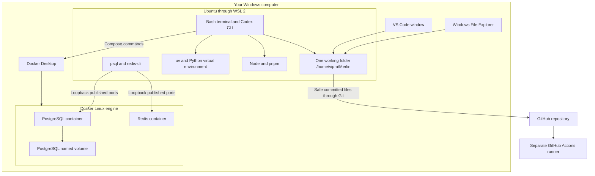
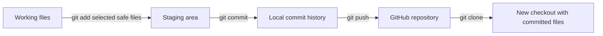
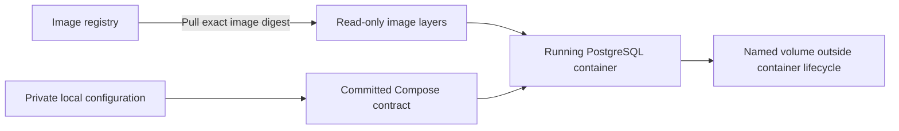
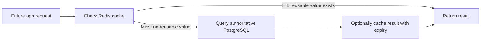
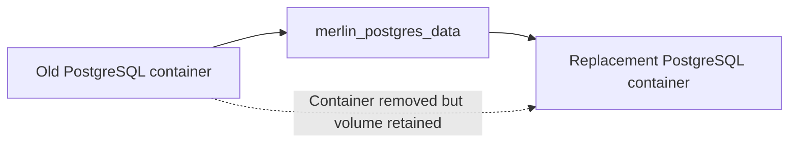
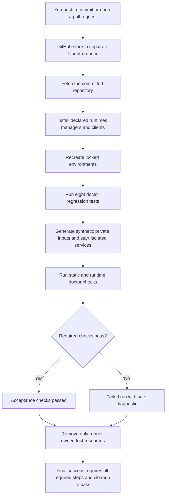
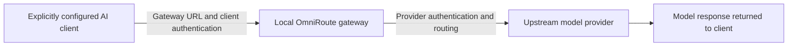

# Sprint 0 — your setup, explained simply

**Sprint 0 prepared the place where you will build Merlin. It did not build the app.** Read one section at a time: what each tool does, why it is here, and one important distinction.

**View the pictures:** in VS Code press **Ctrl+K**, then **V**. If Mermaid appears as code, use Markdown Preview Mermaid Support.

Use [terminal commands](../setup/terminal-commands.md) for exact commands, [SETUP](../setup/local-setup.md) for reproduction and [Part 17](../sprints/part-17-sprint0.md) for evidence. Reading stays inside existing learning time; actual setup minutes remain unknown.

## 1. Where your project lives



**Windows is your host. Ubuntu is your development environment.** WSL 2 lets Linux run alongside Windows. VS Code's window is on Windows, but its WSL server and terminal work in Ubuntu.

There is **one active folder**, viewed two ways:

| View | Address |
|---|---|
| Ubuntu terminal | `/home/vipra/Merlin` |
| Windows Explorer | `\\wsl.localhost\Ubuntu\home\vipra\Merlin` |

The old `C:\Users\vipra\Merlin` is a stale separate copy. Develop in Ubuntu; the active views need no synchronization.

- **Bash / PowerShell:** Linux / Windows shells that interpret commands.
- **WSL extension:** connects VS Code to Ubuntu. Check for `WSL: Ubuntu`.
- **Python extension / Pylance / debugger:** select Python, analyze code and step through execution.
- **RAM / swap / disk / GPU:** working memory / slower disk-backed memory / saved files / specialized processor. WSL has its own allocation; GPU visibility does not prove model performance.

**Why:** consistent Linux tools and paths. This reduces platform differences; it does not guarantee every device can run the app.

📚 Learn first: [WSL filesystems](https://learn.microsoft.com/en-us/windows/wsl/filesystems), Windows/Linux file access; [VS Code WSL](https://code.visualstudio.com/docs/remote/wsl), opening a folder; stop before optional customization.
↩ Return: locate the same file through Explorer and the Ubuntu terminal, then explain where the editor, tools and data run. Do this within the existing learning block.

## 2. Git, GitHub, Jira and account security



**Git saves reviewable history. GitHub hosts it. Jira tracks work.**

| Action | Meaning |
|---|---|
| Stage | Choose safe files for the next commit. |
| Commit | Save a tracked snapshot locally; its hash identifies it. |
| Push | Publish commits to GitHub. |
| Clone | Get committed history into a new folder. |
| Branch / pull request | Separate work / propose it for review. Neither automatically merges it. |

`.gitignore` excludes local files from normal tracking. It does **not** remove a secret already committed. Git author identity is not login authentication.

**SSH keys authenticate Git operations. MFA resists stolen-password use in browser accounts.** GitHub SSH does not protect Jira or establish GitHub browser MFA. Keep private keys and recovery codes private; MFA does not prevent every attack.

Jira `MER` is learner-confirmed Free, team-managed Scrum. Done means acceptance checks pass. Keep at most two active items; record blockers and next actions. Actual setup minutes are **unknown**. Setup overruns replace equal future feature minutes, not add hours.

**Why:** recover changes, review work and keep scope visible.

📚 Learn first: [Git recording changes](https://git-scm.com/book/en/v2/Git-Basics-Recording-Changes-to-the-Repository), tracked/staged files; [GitHub SSH](https://docs.github.com/en/authentication/connecting-to-github-with-ssh), key authentication; stop before account administration.
↩ Return: describe commit, push and clone, identify one ignored private file, and explain why Jira still needs its own MFA. Do not publish keys or recovery codes.

## 3. Python, Node and dependency tools

**A runtime executes code. A package manager prepares dependencies. Neither is the app itself.**

| Tool/file | Job |
|---|---|
| Python / Node | Execute Python / JavaScript. Planned backend / future frontend tooling. |
| uv / pnpm | Manage Python environments/packages / JavaScript packages. |
| `.venv` / `node_modules` | Installed local environments; regenerate instead of commit. |
| `.python-version` | Select Python. |
| `pyproject.toml` / `package.json` | Declare project settings and dependencies. |
| `uv.lock` / `pnpm-lock.yaml` | Record resolved inputs to avoid silent version changes. |

Current pins: **Python 3.12.14, uv 0.12.21, Node 24.21.0, pnpm 12.8.1**. Locks reduce drift; they do not guarantee compatibility or security. No application packages are declared yet; the JavaScript test is still a failing placeholder.

**Why:** another checkout should recreate the declared environment. Locked/frozen installation checks the committed resolution instead of silently replacing it.

📚 Learn first: [uv locking/syncing](https://docs.astral.sh/uv/concepts/projects/sync/), locked installs; [pnpm installation](https://pnpm.io/installation), supported setup; stop before feature dependencies.
↩ Return: identify which files are committed and which directories are regenerated, then explain why uv is not your API. Resolve application packages only at funded first use.

## 4. Docker and Compose



- **Image:** packaged files, programs and startup instructions.
- **Container:** a running image instance. It shares a host kernel; it is not a full separate virtual machine.
- **Docker Desktop / engine:** supplies and runs Linux containers on this host.
- **Compose:** reads `docker-compose.yml` and starts services with declared settings.
- **Tag / digest:** readable release label / exact image-content identifier. Pins prevent silent drift, not every vulnerability.

Our services are `postgres` and `redis`. Their shared network lets containers address them by service name.

| Setting | Purpose / current limits |
|---|---|
| CPU / memory | PostgreSQL **1 CPU / 1 GiB**; Redis **0.5 CPU / 256 MiB**. Ceilings, not reserved hardware. |
| Health | **30s** start period, **10s** interval, **5s** timeout, **5** retries. Allow startup, then check responses. |
| Logs | Rotate at **10m**, keep **3 files**. Review logs for secrets. |
| Process / lifecycle | Observed **UID 999**, non-root; `unless-stopped`; **30s** graceful stop. Not complete security. |

**Why:** a versioned recipe replaces undocumented manual server setup.

📚 Learn first: [Compose model](https://docs.docker.com/compose/intro/compose-application-model/), services/networks/volumes; [Compose services](https://docs.docker.com/reference/compose-file/services/), health/resources/logging; stop before deployment examples.
↩ Return: find each contract field in the Compose file and explain its purpose. Review safely; do not print the resolved configuration.

## 5. PostgreSQL and storage types

**PostgreSQL is the database server. `psql` is a client that sends SQL commands.** A future Python app will also be a client.

Relational storage uses tables, rows, columns and relationships:

```text
USERS                 NOTES — future example, not built
id   name             id   owner_id   title
7    Asha             51   7          Docker notes

User 7 owns note 51.
```

A **primary key** identifies a row; a **foreign key** connects rows. A **constraint** rejects invalid data. A **join** combines related records. An **index** speeds some lookups but costs storage/write work. A **migration** changes database structure in a reviewed, versioned way.

A **transaction** groups changes: commit keeps them; rollback cancels uncommitted changes. PostgreSQL uses a write-ahead log for recovery. Database authentication controls connections; future app authorization must separately control whose notes a user can access.

| Storage kind | Example | Good for |
|---|---|---|
| Relational | PostgreSQL | Related records, rules and transactions |
| Key-value | Redis | Reusable values and counters |
| Document | MongoDB | Nested documents |
| Object | S3 | Files retrieved by key |
| Filesystem | Ubuntu / Docker volume | Source and database-managed files |
| Vector search | pgvector | Similarity search over embeddings |
| Graph | Graph database | Nodes, edges and paths |

Only PostgreSQL, Redis and filesystem storage are used in this setup. Other entries are examples or deferred. Categories can overlap; NoSQL is not automatically faster.

**Why PostgreSQL:** durable related records with constraints and transactions. App tables are not built yet.

## 6. Redis and caching



**Caching reuses a result instead of repeating work.** For example, reuse a recently calculated count. A TTL sets an expiry; invalidation removes stale results.

**The diagram is a future example, not implemented Merlin behavior.** PostgreSQL is the planned source of truth. Cached data should be rebuildable.

`PING` returning `PONG` proves Redis responds. Our Redis disables snapshots and AOF writes, limits data to **128 MiB**, and uses **noeviction**: memory-growing writes may fail when full instead of removing keys. It is not an LRU cache. Redis process recreation may lose keys; no application cache or queue is built.

**Why:** Redis is available for later caching when measurement justifies it; important records remain in PostgreSQL.

📚 Learn first: [PostgreSQL tutorial](https://www.postgresql.org/docs/17/tutorial.html), architecture/tables/queries; [PostgreSQL transactions](https://www.postgresql.org/docs/17/tutorial-transactions.html), commit/rollback; [Redis CLI](https://redis.io/docs/latest/develop/tools/cli/), PING; stop before application implementation.
↩ Return: label client, server, database and volume in your own drawing, then explain which data must survive Redis loss. App schemas and drivers remain learner-written Sprint 1 work.

## 7. Volumes, ports and secrets



**A named volume stores database files independently of the container.** A replacement container can attach it. Ordinary `docker compose down` retains named volumes. **Never delete the original database volume to fix authentication.**

Retention checks that the same volume and PostgreSQL cluster return. An independent clone should have a different cluster. Here, “cluster” means one server's managed databases, not a distributed fleet. **A volume is not a backup**: it can be deleted or lost with its host.

Read ports as:

```text
127.0.0.1 : 5432 : 5432
host address  host port  container port
```

Loopback (`127.0.0.1`) means local access. Ubuntu clients use the published host port; another Compose container uses `postgres:5432`. Inside a container, `localhost` means that container. Clones can publish different host ports. Loopback limits ordinary remote access, not local processes or Docker administrators.

| Item | Meaning |
|---|---|
| `.env` | Private local inputs/password; never commit. |
| `.env.example` | Safe variable names without a usable password; commit. |
| Mode `0600` | Owner read/write only; not encryption. |
| VS Code environment warning | Python terminal injection is separate from Compose reading `.env`. |

Changing `.env` does **not** rotate an existing database password: initialization only sets it on an empty data directory. Environment variables are not a secret vault. Never publish resolved Compose output, unrestricted inspection or environment dumps.

**Why:** separate replaceable processes, retained data and private configuration.

📚 Learn first: [Docker volumes](https://docs.docker.com/engine/storage/volumes/), lifecycle; [Compose services](https://docs.docker.com/reference/compose-file/services/), published ports; stop before destructive cleanup.
↩ Return: explain what remains after ordinary `down`, identify both sides of a port mapping, and explain why replacing `.env` does not rotate an existing password. Preserve the original volume.

## 8. Setup helper, doctor and three different proofs

| Added item | What it does |
|---|---|
| README / SETUP | Explain purpose, prerequisites, startup and cleanup. |
| `tools/setup_local.py` | Create private inputs when absent and start services; preserve existing `.env` and volumes. |
| `tools/doctor.py` | Check setup without starting, stopping or repairing it. |
| `tools/test_doctor.py` | Eight tests check diagnostic safety/failure handling, not app features. |

Doctor checks versions/locks, secrets, health, ports, limits, logs, ownership, volumes, PostgreSQL passwords and Redis policy. Native Ubuntu clients test host access; container clients test internal access.

| Proof | Question |
|---|---|
| Health | Does the service respond to readiness checks? |
| Authentication | Does the right password work and a wrong password get explicitly rejected? |
| Retention | Does the same cluster return after container recreation? |

**One can pass while another fails.** A healthy new empty database can fail retention. A timeout does not prove password rejection.

Doctor prints PASS/WARN/FAIL. Required failures return a nonzero exit code so automation stops. Application tests are N/A. Sanitized evidence records useful results without credentials.

**Why:** find the failing boundary instead of guessing or deleting data.

📚 Learn first: [Part 04 verification contract](../setup/part-04-environment-setup.md#s8-03--runtime-authentication-and-process-proof), expected outcomes; stop before optional installers.
↩ Return: run `uv run --locked python tools/doctor.py` in the Ubuntu checkout, pick one PASS and explain its exact limit. Do not treat the application N/A warning as an app test pass.

## 9. CI: automatic checks on GitHub



**CI means continuous integration: automatically check published changes so problems are caught early.** GitHub Actions runs our recipe on a separate machine, not your laptop database.

| Word | Meaning |
|---|---|
| Trigger | Push, pull request or manual request starts a run. |
| Workflow | Recipe: `.github/workflows/setup.yml`. |
| Runner | GitHub's machine executing it. |
| Job / step / action | Group of operations / one operation / reusable automation. |
| Green run | Required checks and cleanup passed for that commit. |

Our workflow installs pinned tools, recreates locks, tests doctor, starts isolated services with synthetic credentials, checks them and removes **only its own** resources. Repository permissions are read-only. No private dump, paid provider key or AWS deployment is used.

Local checks passed before hosted CI found workflow and pnpm-installer mistakes. We fixed the causes rather than weakening checks. **That is why independent checks matter.**

Green setup CI proves setup worked on that runner. It does **not** prove login, notes, an API, backups or production security. CI checks changes; delivery/deployment (CD) is not implemented here.

📚 Learn first: [Understanding GitHub Actions](https://docs.github.com/en/actions/get-started/understand-github-actions), workflows/jobs/steps/runners; stop before deployment tutorials.
↩ Return: open [Merlin Actions](https://github.com/vipravlipare/Merlin/actions), identify the commit and first failed/passing step, then explain which claims the run supports. See Part 17 for observed results rather than assuming the latest run is green.

## 10. Why test a fresh clone?

**A clone gets committed files, not hidden machine setup.**

| Git provides | Supply separately |
|---|---|
| Instructions, Compose, locks and scripts | Private `.env`, host tools/clients, installed dependencies and database contents |

That is why local work may fail after cloning. Our documented path uses locks and generates new private inputs; host prerequisites are listed separately from the five project commands. Each checkout gets separate project/network/ports/volumes so a test cannot reuse the original database.

The unchanged published clone passed; exact evidence is in Part 17. **Why:** catch untracked dependencies without copying secrets.

📚 Learn first: [SETUP](../setup/local-setup.md), prerequisites and five-command path; [Compose project model](https://docs.docker.com/compose/intro/compose-application-model/), project isolation; stop before cleanup commands.
↩ Return: name three things a clone does not carry and explain how setup supplies them safely. Never copy the original `.env` or reuse its volume for a disposable test.

## 11. Codex, skills and optional OmniRoute



**Codex assists work. Skills give it instructions. A gateway connects an explicitly configured client to model providers.** These are different things.

| Item | Purpose |
|---|---|
| `AGENTS.md` | Persistent user/project instructions. |
| Caveman | Concise chat; normal English in learning files. |
| Cavecrew / review skills | Focused delegation or checks; findings still need proof. |
| OmniRoute skills | Manage routing, providers, compression and gateway health. |
| Global / project skills | Local user / checkout availability; not automatic activation on every ChatGPT/cloud device. |

The diagram shows a **possible path**, not the current Codex connection. Gateway port: **20128**; tested API prefixes: `/v1` and `/api/v1`. Dashboard, API address and key serve different jobs.

A **gateway key** permits client access; a **provider credential** permits upstream access. OAuth authorizes through the provider. Keep keys/tokens private. A listed connection or saved compression setting does not prove model/tool calls, free usage or token savings.

Skills are installed, but Codex still uses its default provider. ChatGPT-wide gateway routing is unproved. The optional `systemctl --user` service is separate from Compose. Do not replace a working connection with an untested gateway.

📚 Learn first: [Part 17 gateway evidence](../sprints/part-17-sprint0.md#live-gateway-verification--october-6-follow-up), tested results and limits; [command reference](../setup/terminal-commands.md), optional service commands; stop before replacing providers.
↩ Return: explain skill availability versus connected inference, and gateway-key versus provider-key. Do not change a working model connection or add paid services merely to complete Sprint 0.

## 12. Small tools: know their jobs

| Group | Meaning |
|---|---|
| `cd`, `pwd`, `ls`; PATH; `/`, `~`, `$HOME` | Navigate files and find programs. Dotfiles are hidden, not automatically protected. |
| `cat`, `rg`, `curl` | Read, search, make HTTP requests; do not expose secrets. |
| HTTP / API / URL | Request/response protocol / interface / address. 200 success; 401 authentication needed; 403 refusal; 5xx server failure. Check the actual result too. |
| apt / sudo; npm / Corepack | Install Ubuntu tools with appropriate privileges; install or launch JavaScript managers. |
| Rootless clients / library path | User-installed clients and their libraries; host prerequisites, not cloned files. |
| YAML / TOML / JSON / Markdown / HTML | Compose/CI / Python settings / structured data / docs / browser quiz formats. |
| stdout / stderr / exit code | Normal output / error output / success-or-failure signal. Doctor keeps raw output private. |
| Manifest / digest / UID / Docker context | Image metadata / content ID / process identity / selected engine. |
| `pg_isready` / cluster tools / Redis CONFIG | Readiness / database identity / cache settings. |
| Docker logs / stats / inspection | Observe output, resources and selected state; redact secrets. |
| Tests / evidence / benchmarks | Check behavior / record observations / measure performance. Smoke tests are not benchmarks. |
| WIP / spill / go-no-go | Limit active work / swap overrun with funded work / decide bounded readiness. |

📚 Learn first: [terminal reference](../setup/terminal-commands.md), safe daily commands; [Part 04 evidence](../setup/part-04-environment-setup.md), selected inspections and resource limits; stop before optional installs.
↩ Return: choose five unfamiliar terms, point to where each was used, and explain which boundary it affects. Learn within the existing ritual/reading time; you do not need to memorize every CLI flag.

## 13. What to remember and explain

**Sprint 0 setup passes; application features remain learner-written.** Schemas, login, owner filtering, API/UI, backups and measured AI features are future work. AWS, optional installers and DSA remain deferred. Do not claim assistant-prepared setup as entirely your authored code.

For interviews, explain the reasons: **Linux consistency, Git history, Jira scope, locked dependencies, repeatable containers, durable PostgreSQL, disposable Redis, private inputs and independent checks.** Installed tools do not prove features or mastery.

Answer these five questions in your own words, without copying the guide:

1. What does a fresh clone lack that the working directory may contain, and how do committed setup instructions supply it safely?
2. What do health, correct/wrong passwords and cluster retention each prove? Why can one pass while another fails?
3. Why can two clones use the same Compose file without sharing database data now?
4. What triggers CI, where does it run, and what does green setup CI not prove about Merlin?
5. Why is a retained named volume useful but not a backup? Why is an installed skill not proof of active inference routing?

Grade each answer: 0 missing/incorrect, 1 partly correct, 2 correct with the reason. Pass requires at least 8/10 with no unresolved secret-publication, authentication or destructive-cleanup misconception. Retest missed ideas. Draw host/container/storage boundaries in 60 seconds, then do a spaced re-quiz 2–3 days after understanding the missed concepts. Your existing [browser quiz](../../quizzes/sprint-0-quiz.html) remains available; MCQ success complements rather than replaces explain-back.

📚 Learn first: the diagrams and Sections 7–9 above; stop before answers or new implementation.
↩ Return: provide your five short answers, record the grade and the drawing/re-quiz result in Part 17. Actual minutes may remain honestly unknown; DSA is not a required gate.

### References

Section links provide optional detail. Official resources were inspected during October 1–6 setup work; this shorter edit does not claim a new web audit. Learning and account evidence remain separate from software checks.
